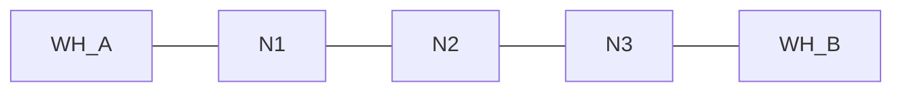
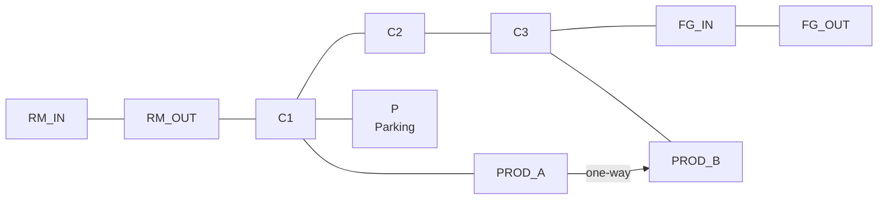
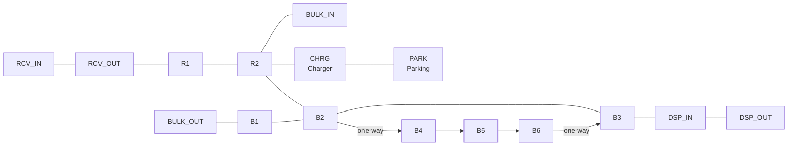
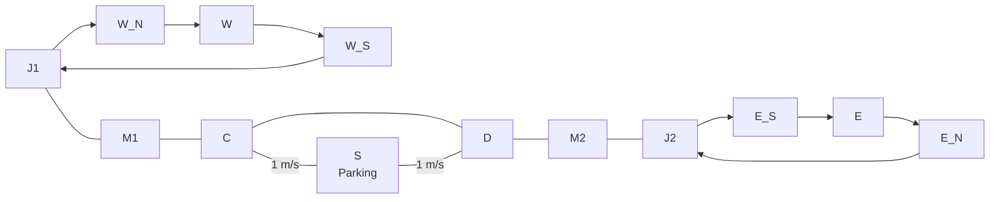

# Intralogistics examples

For generated lattices, lanes, ports and migration from explicit graphs, see the [layout guide](../guides/layout.md).

Four runnable scripts in [`examples/`](https://github.com/dmezzogori/simulatte/tree/main/examples) form a progressive learning path --- from a minimal setup to a full-shift warehouse operation, then traffic control. The first three run under the default `FreeFlowController`, in which vehicles never wait for one another; the fourth uses `ReservationController`.

See also: [Intralogistics API](../api/intralogistics.md)

| Example | Layout | AGVs | SKUs | Key features |
|---------|--------|------|------|--------------|
| [Simple](#simple) | 5 nodes (preset) | 2 | 1 | `build_simple_system`, text output |
| [Intermediate](#intermediate) | 10 nodes (manual) | 3 | 3 | Custom graph, dispatch strategy, parking, staggered orders, plots |
| [Advanced](#advanced) | 16 nodes (manual) | 5 | 5 | 3 warehouses, battery lifecycle, charging, replenishment, EMA metrics, 4 plots |
| [Traffic](#traffic) | 13 nodes (manual) | 3 | 1 | `ReservationController`, `FastestRouter`, a passing place, `TrafficKPIs` |

---

## Simple

**File:** [`examples/intralogistics_simple.py`](https://github.com/dmezzogori/simulatte/blob/main/examples/intralogistics_simple.py)

The minimal starting point. Uses `build_simple_system()`, on the environment's layout, to create a 5-node linear graph with two warehouses and two AGVs. Submits four transfer orders and prints results.



**What it demonstrates:**

- Using `build_simple_system()` for quick setup
- Creating orders with `coordinator.create_order()` and `coordinator.submit()`
- Reading results: order status, inventory levels, fleet utilization

**Run it:**

```bash
uv run python examples/intralogistics_simple.py
```

### Run it in the browser

```python { .run }
from __future__ import annotations

from simulatte.environment import Environment
from simulatte.intralogistics import OrderStatus, SKU, build_simple_system


def fmt_time(value: float | None) -> str:
    return "-" if value is None else f"{value:6.1f}"


def main() -> None:
    with Environment() as env:
        # The builder declares its five-node line on the environment's layout and builds everything on handles.
        coordinator, agvs, warehouse_a, warehouse_b, _ = build_simple_system(env, layout=env.layout)

        sku = SKU("A", weight=1.0, volume=0.1)
        quantities = [5, 8, 12, 6]

        initial_a = warehouse_a.get_inventory_level(sku)
        initial_b = warehouse_b.get_inventory_level(sku)

        orders = []
        for quantity in quantities:
            order = coordinator.create_order(
                sku=sku,
                quantity=quantity,
                origin=warehouse_a,
                destination=warehouse_b,
            )
            coordinator.submit(order)
            orders.append(order)

        env.run(until=120.0)

        completed = sum(order.status is OrderStatus.COMPLETED for order in orders)

        print("Simple intralogistics example")
        print(f"Layout nodes: {len(coordinator.graph.nodes)}")
        print(f"AGVs: {len(agvs)}")
        print(f"Simulation time: {env.now:.1f}")
        print(f"Completed orders: {completed}/{len(orders)}")
        print()
        print(f"WH-A inventory: {initial_a:.0f} -> {warehouse_a.get_inventory_level(sku):.0f}")
        print(f"WH-B inventory: {initial_b:.0f} -> {warehouse_b.get_inventory_level(sku):.0f}")
        print()
        print("order qty status     dispatch   pick deliver agv")
        for idx, order in enumerate(orders, start=1):
            agv_id = order.assigned_agv.agv_id if order.assigned_agv is not None else "-"
            print(
                f"{idx:>5} {order.quantity:>3} {order.status.name:<10}"
                f" {fmt_time(order.dispatched_at)}"
                f" {fmt_time(order.picked_at)}"
                f" {fmt_time(order.delivered_at)} {agv_id}"
            )

        print()
        print(f"Fleet utilization: {coordinator.fleet_utilization:.1%}")
        for agv in coordinator.agv_report():
            print(
                f"{agv['agv_id']}: state={agv['state']}, battery={agv['battery_pct']:.1%}, node={agv['current_node']}"
            )


if __name__ == "__main__":
    main()
```

---

The examples that plot require `pip install "simulatte[plot]"`; call `main(plot=False)` for a headless run.

## Intermediate

**File:** [`examples/intralogistics_intermediate.py`](https://github.com/dmezzogori/simulatte/blob/main/examples/intralogistics_intermediate.py)

A manufacturing plant with Raw Materials and Finished Goods warehouses connected by a corridor with production floor branches. Builds everything manually --- no builder functions.



All corridor arcs are bidirectional. `PROD_A → PROD_B` is one-way, providing a forward bypass when the main corridor is busy.

**What it demonstrates:**

- **Custom graph construction** --- manual `Node`, `Arc`, and `LayoutGraph`, declared as the network of `env.layout` with `Explicit`, instead of a builder
- **Multiple SKUs** --- Steel Sheets (80 kg), Plastic Pellets (15 kg), Electronics (2 kg) with weight/volume capacity constraints
- **Dispatch strategy** --- `NearestIdleStrategy` selects the closest idle AGV for each order
- **Parking and repositioning** --- `ParkingArea` at node P with `NearestParkingPolicy` sending idle AGVs back to parking
- **Staggered order batches** --- three batches at t=0, t=30 min, and t=60 min to show queuing dynamics
- **Time-series plots** --- `FleetTimeSeries` with `plot_fleet_utilization()` and `plot_pending_orders()`

**Key configuration:**

```python
# 3 AGVs with trapezoidal speed profile
speed_profile = TrapezoidalProfile(max_speed=1.5, acceleration=0.8, deceleration=1.0)
agv_type = AGVType(
    name="standard",
    speed_profile=speed_profile,
    battery_capacity=200.0,
    weight_capacity=100.0,
    volume_capacity=3.0,
    ...
)

# 8 orders across 3 batches, all Raw Materials -> Finished Goods
batches = [
    (0,    [(steel, 1), (plastic, 2), (electronics, 3)]),
    (1800, [(steel, 1), (plastic, 3), (plastic, 2)]),
    (1800, [(electronics, 3), (steel, 1)]),
]
```

**Sample output:**

```
Manufacturing Plant Floor — Intermediate Example
Layout: 10 nodes, 10 arcs
Fleet: 3 AGVs
Simulation time: 7200s (120 min)
Orders: 8 submitted, 8 completed, 0 failed
Avg fulfillment time: 144.6s
```

**Run it:**

```bash
uv run --extra plot python examples/intralogistics_intermediate.py
```

### Run it in the browser

Click ▶ Run --- the time-series plots render below the text output.

```python { .run }
"""Intralogistics simulation with plots; install ``simulatte[plot]`` to run directly.

Call ``main(plot=False)`` to run without plotting dependencies.
"""

from __future__ import annotations

from simpy.events import ProcessGenerator

from simulatte.environment import Environment
from simulatte.intralogistics import (
    AGV,
    AGVType,
    Arc,
    FleetCoordinator,
    FleetTimeSeries,
    LayoutGraph,
    NearestIdleStrategy,
    NearestParkingPolicy,
    Node,
    OrderStatus,
    ParkingArea,
    SKU,
    TrapezoidalProfile,
    Warehouse,
)
from simulatte.layout import Explicit


def fmt_time(value: float | None) -> str:
    return "-" if value is None else f"{value:7.1f}"


def order_batches(
    env: Environment,
    coordinator: FleetCoordinator,
    raw_materials: Warehouse,
    finished_goods: Warehouse,
    skus: list[SKU],
    orders: list,
) -> ProcessGenerator:
    steel, plastic, electronics = skus
    batches: list[tuple[float, list[tuple[SKU, int]]]] = [
        (0, [(steel, 1), (plastic, 2), (electronics, 3)]),
        (1800, [(steel, 1), (plastic, 3), (plastic, 2)]),
        (1800, [(electronics, 3), (steel, 1)]),
    ]
    for delay, batch in batches:
        if delay > 0:
            yield env.timeout(delay)
        for sku, quantity in batch:
            order = coordinator.create_order(
                sku=sku,
                quantity=quantity,
                origin=raw_materials,
                destination=finished_goods,
            )
            orders.append(order)
            coordinator.submit(order)


def main(*, plot: bool = True) -> None:
    with Environment() as env:
        # --- Nodes ---
        rm_in = Node(id="RM_IN", x=0, y=0)
        rm_out = Node(id="RM_OUT", x=20, y=0)
        c1 = Node(id="C1", x=40, y=0)
        c2 = Node(id="C2", x=60, y=0)
        c3 = Node(id="C3", x=80, y=0)
        fg_in = Node(id="FG_IN", x=100, y=0)
        fg_out = Node(id="FG_OUT", x=120, y=0)
        prod_a = Node(id="PROD_A", x=40, y=-25)
        prod_b = Node(id="PROD_B", x=80, y=-25)
        p = Node(id="P", x=40, y=25)

        all_nodes = [rm_in, rm_out, c1, c2, c3, fg_in, fg_out, prod_a, prod_b, p]

        # --- Arcs ---
        arcs = [
            Arc(rm_in, rm_out, bidirectional=True),
            Arc(fg_in, fg_out, bidirectional=True),
            Arc(rm_out, c1, bidirectional=True),
            Arc(c1, c2, bidirectional=True),
            Arc(c2, c3, bidirectional=True),
            Arc(c3, fg_in, bidirectional=True),
            Arc(c1, p, bidirectional=True),
            Arc(c1, prod_a, bidirectional=True),
            Arc(c3, prod_b, bidirectional=True),
            Arc(prod_a, prod_b, bidirectional=False),
        ]

        graph = LayoutGraph(all_nodes, arcs)

        # The graph is the network of the environment's layout; everything below refers to it through handles.
        layout = env.layout
        layout.set_network(Explicit(graph))

        # --- SKUs ---
        steel = SKU(id="Steel Sheets", weight=80.0, volume=0.3)
        plastic = SKU(id="Plastic Pellets", weight=15.0, volume=0.8)
        electronics = SKU(id="Electronics", weight=2.0, volume=0.5)
        skus = [steel, plastic, electronics]

        # --- Warehouses ---
        def pick_time(sku: SKU, qty: int) -> float:
            return 15.0 + qty * 5.0

        def put_time(sku: SKU, qty: int) -> float:
            return 10.0 + qty * 3.0

        raw_materials = Warehouse(
            env=env,
            name="Raw Materials",
            input_bays=[layout.node("RM_IN")],
            output_bays=[layout.node("RM_OUT")],
            n_slots=2,
            products=skus,
            initial_inventory={sku: 20 for sku in skus},
            pick_time=pick_time,
            put_time=put_time,
        )

        finished_goods = Warehouse(
            env=env,
            name="Finished Goods",
            input_bays=[layout.node("FG_IN")],
            output_bays=[layout.node("FG_OUT")],
            n_slots=2,
            products=skus,
            initial_inventory={sku: 0 for sku in skus},
            pick_time=pick_time,
            put_time=put_time,
        )

        # --- Fleet ---
        speed_profile = TrapezoidalProfile(
            max_speed=1.5,
            acceleration=0.8,
            deceleration=1.0,
        )
        agv_type = AGVType(
            name="standard",
            speed_profile=speed_profile,
            battery_capacity=200.0,
            weight_capacity=100.0,
            volume_capacity=3.0,
            depletion_fn=lambda distance, load_weight, speed: distance * 0.01,
            load_time=10.0,
            unload_time=8.0,
        )
        starting_nodes = [layout.node("RM_OUT"), layout.node("C2"), layout.node("P")]
        agvs = [
            AGV(env=env, agv_type=agv_type, agv_id=f"AGV-{i + 1}", initial_node=node)
            for i, node in enumerate(starting_nodes)
        ]

        # --- Parking ---
        parking = ParkingArea(env=env, name="Parking", node=layout.node("P"), capacity=3)

        # --- Coordinator ---
        coordinator = FleetCoordinator(
            env=env,
            graph=layout.graph(),
            fleet=agvs,
            warehouses=[raw_materials, finished_goods],
            charging_stations=[],
            parking_areas=[parking],
            dispatch_strategy=NearestIdleStrategy(),
            repositioning_policy=NearestParkingPolicy(),
        )

        # --- Metrics ---
        ts_collector = FleetTimeSeries(coordinator).attach(env)

        # Record initial inventory
        initial_rm = {sku: raw_materials.get_inventory_level(sku) for sku in skus}
        initial_fg = {sku: finished_goods.get_inventory_level(sku) for sku in skus}

        # Start order generation
        orders: list = []
        env.process(order_batches(env, coordinator, raw_materials, finished_goods, skus, orders))

        # Run simulation (120 minutes)
        env.run(until=7200.0)

        # --- Text output ---
        completed_orders = [o for o in orders if o.status is OrderStatus.COMPLETED]
        failed = sum(1 for o in orders if o.status is OrderStatus.FAILED)
        avg_fulfillment = 0.0
        if completed_orders:
            avg_fulfillment = sum(
                o.delivered_at - o.created_at for o in completed_orders if o.delivered_at is not None
            ) / len(completed_orders)

        print("Manufacturing Plant Floor — Intermediate Example")
        print(f"Layout: {len(graph.nodes)} nodes, {len(arcs)} arcs")
        print(f"Fleet: {len(agvs)} AGVs")
        print(f"Simulation time: {env.now:.0f}s ({env.now / 60:.0f} min)")
        print(f"Orders: {len(orders)} submitted, {len(completed_orders)} completed, {failed} failed")
        print(f"Avg fulfillment time: {avg_fulfillment:.1f}s")
        print()

        print("order sku                   qty status     dispatch    pick deliver agv")
        for idx, order in enumerate(orders, start=1):
            agv_id = order.assigned_agv.agv_id if order.assigned_agv is not None else "-"
            print(
                f"{idx:>5} {order.sku.id:<22} {order.quantity:>3} {order.status.name:<10}"
                f" {fmt_time(order.dispatched_at)}"
                f" {fmt_time(order.picked_at)}"
                f" {fmt_time(order.delivered_at)} {agv_id}"
            )

        print()
        print("Fleet report:")
        for info in coordinator.agv_report():
            print(
                f"  {info['agv_id']}: utilization={info['utilization']:.1%},"
                f" state={info['state']}, node={info['current_node']}"
            )

        print()
        print("Warehouse inventory:")
        for sku in skus:
            rm_now = raw_materials.get_inventory_level(sku)
            fg_now = finished_goods.get_inventory_level(sku)
            print(
                f"  {sku.id:<22} RM: {initial_rm[sku]:>3.0f} -> {rm_now:>3.0f}"
                f"  FG: {initial_fg[sku]:>3.0f} -> {fg_now:>3.0f}"
            )

        # --- Plots ---
        if plot:
            ts_collector.plot_fleet_utilization()
            ts_collector.plot_pending_orders()


if __name__ == "__main__":
    main()
```

---

## Advanced

**File:** [`examples/intralogistics_advanced.py`](https://github.com/dmezzogori/simulatte/blob/main/examples/intralogistics_advanced.py)

A distribution hub with three warehouses --- Receiving (inbound), Bulk Storage (central), and Dispatch (outbound) --- running a full 8-hour shift. Goods flow inbound via automatic replenishment and outbound via continuous customer orders.



Main corridors are bidirectional. The `B2 → B4 → B5 → B6 → B3` alternate route is one-way, giving the router a forward bypass option.

**What it demonstrates:**

- **3-warehouse topology** --- Receiving, Bulk Storage, and Dispatch with separate input/output bays
- **Battery lifecycle** --- `TrapezoidalProfile` with `battery_degradation_fn` (speed drops below 30% charge) and `load_speed_factor_fn` (heavier loads = slower)
- **Charging station** --- `ChargingStation` at CHRG with 2 slots; AGVs charge automatically when battery is low
- **Automatic replenishment** --- `ReorderPointPolicy` monitors Bulk Storage inventory and triggers transfers from Receiving when stock drops below thresholds
- **Round-robin dispatch** --- `RoundRobinStrategy` cycles through idle AGVs for balanced fleet utilization
- **Load recovery** --- `ReturnToOrigin` returns cargo to the origin warehouse if an AGV is interrupted
- **EMA metrics** --- `OrderEMACollector` (with `alpha=0.05`, in place of the coordinator's default) tracks fulfillment time, dispatch delay, travel times (empty/loaded), and late order rate
- **4 time-series plots** --- fleet utilization, throughput, pending orders, and inventory levels over time

**Key configuration:**

```python
# 5 AGVs with battery degradation and load-dependent speed
speed_profile = TrapezoidalProfile(
    max_speed=2.0, acceleration=0.8, deceleration=1.0,
    battery_degradation_fn=lambda level: 1.0 if level >= 0.3 else 0.7 + level,
    load_speed_factor_fn=lambda weight: max(0.5, 1.0 - weight / 300),
)

# Automatic replenishment when Bulk Storage drops below thresholds
replenishment = ReorderPointPolicy(
    thresholds={pallet_a: 10, pallet_b: 10, ...},
    reorder_quantity={pallet_a: 1, pallet_b: 1, pallet_c: 5, ...},
)
coordinator.add_replenishment_policy(replenishment, bulk_storage)

# Continuous outbound orders at random intervals (5-10 min)
def outbound_order_stream(env, coordinator, ...):
    interval = env.bind(Uniform(300, 600), kind="scalar", stream="outbound-orders/interval", owner="outbound-orders")
    while True:
        yield env.timeout(interval())
        ...
        coordinator.submit(order)
```

**Sample output:**

```
Multi-Warehouse Distribution Hub — Advanced Example
Layout: 16 nodes, 16 arcs
Fleet: 5 AGVs
Simulation time: 28800s (480 min)

Shift summary:
  Total orders: 65 (63 outbound, 2 replenishment)
  Completed: 65, Failed: 0
  Outbound:      63 completed, 0 failed
  Replenishment: 2 completed, 0 failed
  Avg outbound fulfillment time: 204.4s (3.4 min)
```

**Run it:**

```bash
uv run --extra plot python examples/intralogistics_advanced.py
```

**Under traffic control.** The example runs under the default `FreeFlowController`. Run with every vehicle type given
a `length` of 0 and the coordinator on its own `ReservationController`, the same shift completes the same 63
outbound and 2 replenishment orders, with 94 traffic waits, an average outbound fulfillment of about 226 s, 51
make-way moves and 57 service-node clearances. Its 38 deadlocks are all resolved by a step aside, and each victim is
an idle AGV on a make-way move whose route passes `R2`, the node where the AGV it makes way for is waiting (37 moves
`B1 → PARK` and one `BULK_OUT → PARK`): the move meets that AGV head-on. The make-way search checks the target and
the first claim of the route, not the nodes the route passes. One wait is reported stuck (an AGV behind an idle one
on its starting node) and ends at its next review with a grant.

### Run it in the browser

Click ▶ Run --- the time-series plots render below the text output. The full 8-hour shift still completes in a few seconds (showing at least one charging event and the late-shift replenishment).

```python { .run }
"""Intralogistics simulation with plots; install ``simulatte[plot]`` to run directly.

Call ``main(plot=False)`` to run without plotting dependencies.
"""

from __future__ import annotations

from simpy.events import ProcessGenerator

from simulatte.distributions import Uniform
from simulatte.environment import Environment
from simulatte.intralogistics import (
    AGV,
    AGVState,
    AGVType,
    Arc,
    ChargingStation,
    FleetCoordinator,
    FleetTimeSeries,
    LayoutGraph,
    NearestParkingPolicy,
    RoundRobinStrategy,
    Node,
    OrderEMACollector,
    OrderStatus,
    ParkingArea,
    ReorderPointPolicy,
    ReturnToOrigin,
    SKU,
    TrapezoidalProfile,
    Warehouse,
)
from simulatte.layout import Explicit


def fmt_ema(value: float | None) -> str:
    return "-" if value is None else f"{value:.2f}"


def outbound_order_stream(
    env: Environment,
    coordinator: FleetCoordinator,
    bulk_storage: Warehouse,
    dispatch: Warehouse,
    skus: list[SKU],
    orders: list,
    weight_capacity: float,
    volume_capacity: float,
) -> ProcessGenerator:
    rng = env.rng("outbound-orders")
    interval = env.bind(Uniform(300, 600), kind="scalar", stream="outbound-orders/interval", owner="outbound-orders")
    due_offset = env.bind(Uniform(1800, 3600), kind="scalar", stream="outbound-orders/due", owner="outbound-orders")
    while True:
        yield env.timeout(interval())
        sku = rng.choice(skus)
        max_by_weight = max(1, int(weight_capacity // sku.weight))
        max_by_volume = max(1, int(volume_capacity // sku.volume))
        max_qty = min(max_by_weight, max_by_volume)
        quantity = rng.randint(1, min(3, max_qty))
        due_date = env.now + due_offset()
        order = coordinator.create_order(
            sku=sku,
            quantity=quantity,
            origin=bulk_storage,
            destination=dispatch,
            due_date=due_date,
        )
        orders.append(order)
        coordinator.submit(order)


def main(*, plot: bool = True) -> None:
    with Environment(seed=42) as env:
        # --- Nodes (16) ---
        rcv_in = Node(id="RCV_IN", x=0, y=30)
        rcv_out = Node(id="RCV_OUT", x=20, y=30)
        r1 = Node(id="R1", x=50, y=30)
        r2 = Node(id="R2", x=80, y=30)
        bulk_in = Node(id="BULK_IN", x=110, y=30)
        chrg = Node(id="CHRG", x=80, y=15)
        park = Node(id="PARK", x=100, y=15)
        bulk_out = Node(id="BULK_OUT", x=20, y=0)
        b1 = Node(id="B1", x=50, y=0)
        b2 = Node(id="B2", x=80, y=0)
        b3 = Node(id="B3", x=110, y=0)
        dsp_in = Node(id="DSP_IN", x=140, y=0)
        dsp_out = Node(id="DSP_OUT", x=160, y=0)
        b4 = Node(id="B4", x=80, y=-20)
        b5 = Node(id="B5", x=100, y=-20)
        b6 = Node(id="B6", x=110, y=-20)

        all_nodes = [
            rcv_in,
            rcv_out,
            r1,
            r2,
            bulk_in,
            chrg,
            park,
            bulk_out,
            b1,
            b2,
            b3,
            dsp_in,
            dsp_out,
            b4,
            b5,
            b6,
        ]

        # --- Arcs (16) ---
        arcs = [
            # Warehouse bays (bidirectional, adjacent pairs)
            Arc(rcv_in, rcv_out, bidirectional=True),
            Arc(dsp_in, dsp_out, bidirectional=True),
            # Upper corridor (bidirectional)
            Arc(rcv_out, r1, bidirectional=True),
            Arc(r1, r2, bidirectional=True),
            Arc(r2, bulk_in, bidirectional=True),
            # Lower corridor (bidirectional)
            Arc(bulk_out, b1, bidirectional=True),
            Arc(b1, b2, bidirectional=True),
            Arc(b2, b3, bidirectional=True),
            Arc(b3, dsp_in, bidirectional=True),
            # Vertical connector
            Arc(r2, b2, bidirectional=True),
            # Charging / parking branch
            Arc(r2, chrg, bidirectional=True),
            Arc(chrg, park, bidirectional=True),
            # Alternate lower route (one-way forward bypass)
            Arc(b2, b4, bidirectional=False),
            Arc(b4, b5, bidirectional=False),
            Arc(b5, b6, bidirectional=False),
            Arc(b6, b3, bidirectional=False),
        ]

        graph = LayoutGraph(all_nodes, arcs)

        # The graph is the network of the environment's layout; everything below refers to it through handles.
        layout = env.layout
        layout.set_network(Explicit(graph))

        # --- SKUs (5) ---
        pallet_a = SKU(id="Pallet-A-Heavy", weight=120.0, volume=0.5)
        pallet_b = SKU(id="Pallet-B-Medium", weight=50.0, volume=0.8)
        pallet_c = SKU(id="Pallet-C-Light", weight=10.0, volume=0.3)
        pallet_d = SKU(id="Pallet-D-Bulky", weight=30.0, volume=1.2)
        pallet_e = SKU(id="Pallet-E-Small", weight=5.0, volume=0.1)
        skus = [pallet_a, pallet_b, pallet_c, pallet_d, pallet_e]

        # --- Warehouses (3) ---
        def rcv_pick_time(sku: SKU, qty: int) -> float:
            return 20.0 + qty * 3.0

        def rcv_put_time(sku: SKU, qty: int) -> float:
            return 10.0 + qty * 2.0

        def bulk_pick_time(sku: SKU, qty: int) -> float:
            return 25.0 + qty * 4.0

        def bulk_put_time(sku: SKU, qty: int) -> float:
            return 15.0 + qty * 3.0

        def dsp_pick_time(sku: SKU, qty: int) -> float:
            return 15.0 + qty * 2.0

        def dsp_put_time(sku: SKU, qty: int) -> float:
            return 10.0 + qty * 2.0

        receiving = Warehouse(
            env=env,
            name="Receiving",
            input_bays=[layout.node("RCV_IN")],
            output_bays=[layout.node("RCV_OUT")],
            n_slots=3,
            products=skus,
            initial_inventory={sku: 200 for sku in skus},
            pick_time=rcv_pick_time,
            put_time=rcv_put_time,
        )

        bulk_storage = Warehouse(
            env=env,
            name="Bulk Storage",
            input_bays=[layout.node("BULK_IN")],
            output_bays=[layout.node("BULK_OUT")],
            n_slots=4,
            products=skus,
            initial_inventory={sku: 30 for sku in skus},
            pick_time=bulk_pick_time,
            put_time=bulk_put_time,
        )

        dispatch = Warehouse(
            env=env,
            name="Dispatch",
            input_bays=[layout.node("DSP_IN")],
            output_bays=[layout.node("DSP_OUT")],
            n_slots=3,
            products=skus,
            initial_inventory={sku: 0 for sku in skus},
            pick_time=dsp_pick_time,
            put_time=dsp_put_time,
        )

        # --- Fleet (5 AGVs) ---
        speed_profile = TrapezoidalProfile(
            max_speed=2.0,
            acceleration=0.8,
            deceleration=1.0,
            battery_degradation_fn=lambda level: 1.0 if level >= 0.3 else 0.7 + level,
            load_speed_factor_fn=lambda weight: max(0.5, 1.0 - weight / 300),
        )
        agv_type = AGVType(
            name="heavy-duty",
            speed_profile=speed_profile,
            battery_capacity=100.0,
            weight_capacity=150.0,
            volume_capacity=1.5,
            depletion_fn=lambda distance, load_weight, speed: distance * 0.02 * (1.0 + load_weight / 200),
            low_battery_threshold=0.2,
            critical_battery_threshold=0.05,
            load_time=12.0,
            unload_time=10.0,
        )
        starting_nodes = [layout.node(n) for n in ("PARK", "BULK_OUT", "B1", "R1", "B3")]
        agvs = [
            AGV(env=env, agv_type=agv_type, agv_id=f"AGV-{i + 1}", initial_node=node)
            for i, node in enumerate(starting_nodes)
        ]

        # --- Parking & Charging ---
        parking_area = ParkingArea(env=env, name="Parking", node=layout.node("PARK"), capacity=3)
        charging_station = ChargingStation(env=env, name="Charger", node=layout.node("CHRG"), n_slots=2)

        # --- Coordinator ---
        coordinator = FleetCoordinator(
            env=env,
            graph=layout.graph(),
            fleet=agvs,
            warehouses=[receiving, bulk_storage, dispatch],
            charging_stations=[charging_station],
            parking_areas=[parking_area],
            dispatch_strategy=RoundRobinStrategy(),
            repositioning_policy=NearestParkingPolicy(),
            load_recovery_strategy=ReturnToOrigin(),
            default_metrics=False,
        )

        # --- Metrics ---
        order_metrics = OrderEMACollector(coordinator, alpha=0.05).attach(env)
        ts_collector = FleetTimeSeries(coordinator).attach(env)

        # --- Replenishment policy ---
        thresholds = {
            pallet_a: 10,
            pallet_b: 10,
            pallet_c: 10,
            pallet_d: 10,
            pallet_e: 10,
        }
        reorder_quantities = {
            pallet_a: 1,
            pallet_b: 1,
            pallet_c: 5,
            pallet_d: 1,
            pallet_e: 10,
        }
        replenishment = ReorderPointPolicy(
            thresholds=thresholds,
            reorder_quantity=reorder_quantities,
        )
        coordinator.add_replenishment_policy(replenishment, bulk_storage)

        # Record initial inventory and seed time-series baseline
        initial_inv = {
            wh: {sku: wh.get_inventory_level(sku) for sku in skus} for wh in [receiving, bulk_storage, dispatch]
        }
        for wh in [receiving, bulk_storage, dispatch]:
            ts_collector.inventory_ts[wh.id] = [(0.0, {sku.id: float(c.level) for sku, c in wh.inventory.items()})]

        # Track all orders (outbound + replenishment) via hook
        all_orders: list = []
        coordinator.on_order_submitted(lambda order: all_orders.append(order))

        # Start outbound order stream
        outbound_orders: list = []
        env.process(
            outbound_order_stream(
                env,
                coordinator,
                bulk_storage,
                dispatch,
                skus,
                outbound_orders,
                agv_type.weight_capacity,
                agv_type.volume_capacity,
            )
        )

        # Run simulation (8-hour shift = 28800 seconds)
        env.run(until=28800.0)

        # --- Classify orders ---
        replenishment_orders = [o for o in all_orders if o not in outbound_orders]
        completed_outbound = [o for o in outbound_orders if o.status is OrderStatus.COMPLETED]
        failed_out = sum(1 for o in outbound_orders if o.status is OrderStatus.FAILED)
        completed_repl = sum(1 for o in replenishment_orders if o.status is OrderStatus.COMPLETED)
        failed_repl = sum(1 for o in replenishment_orders if o.status is OrderStatus.FAILED)
        total_completed = len(completed_outbound) + completed_repl
        total_failed = failed_out + failed_repl

        avg_fulfillment = 0.0
        if completed_outbound:
            avg_fulfillment = sum(
                o.delivered_at - o.created_at for o in completed_outbound if o.delivered_at is not None
            ) / len(completed_outbound)

        # --- Text output ---
        print("Multi-Warehouse Distribution Hub — Advanced Example")
        print(f"Layout: {len(graph.nodes)} nodes, {len(arcs)} arcs")
        print(f"Fleet: {len(agvs)} AGVs")
        print(f"Simulation time: {env.now:.0f}s ({env.now / 60:.0f} min)")
        print()

        print("Shift summary:")
        n_out = len(outbound_orders)
        n_repl = len(replenishment_orders)
        print(f"  Total orders: {len(all_orders)} ({n_out} outbound, {n_repl} replenishment)")
        print(f"  Completed: {total_completed}, Failed: {total_failed}")
        print(f"  Outbound:      {len(completed_outbound)} completed, {failed_out} failed")
        print(f"  Replenishment: {completed_repl} completed, {failed_repl} failed")
        print(f"  Avg outbound fulfillment time: {avg_fulfillment:.1f}s ({avg_fulfillment / 60:.1f} min)")
        print()

        print("Warehouse inventory (start -> end):")
        for wh in [receiving, bulk_storage, dispatch]:
            print(f"  {wh.name}:")
            for sku in skus:
                start = initial_inv[wh][sku]
                end = wh.get_inventory_level(sku)
                print(f"    {sku.id:<20} {start:>5.0f} -> {end:>5.0f}")
        print()

        print("Fleet report:")
        for info in coordinator.agv_report():
            agv_obj = next(a for a in agvs if a.agv_id == info["agv_id"])
            charging_pct = agv_obj.state_percentage(AGVState.CHARGING)
            print(
                f"  {info['agv_id']}: utilization={info['utilization']:.1%},"
                f" charging={charging_pct:.1%},"
                f" battery={info['battery_pct']:.0%},"
                f" state={info['state']}"
            )
        print(f"  Fleet utilization: {coordinator.fleet_utilization:.1%}")
        print()

        print("EMA metrics:")
        print(f"  Fulfillment time: {fmt_ema(order_metrics.ema_fulfillment_time)}s")
        print(f"  Dispatch delay:   {fmt_ema(order_metrics.ema_dispatch_delay)}s")
        print(f"  Travel (empty):   {fmt_ema(order_metrics.ema_travel_time_empty)}s")
        print(f"  Travel (loaded):  {fmt_ema(order_metrics.ema_travel_time_loaded)}s")
        print(f"  Late order rate:  {fmt_ema(order_metrics.ema_late_orders)}")

        # --- Plots ---
        if plot:
            ts_collector.plot_fleet_utilization()
            ts_collector.plot_throughput()
            ts_collector.plot_pending_orders()
            ts_collector.plot_inventory()


if __name__ == "__main__":
    main()
```

---

## Traffic

**File:** [`examples/intralogistics_traffic.py`](https://github.com/dmezzogori/simulatte/blob/main/examples/intralogistics_traffic.py)

Two warehouses at the ends of a single-lane corridor exchange crates in both directions, under a `ReservationController`: vehicles hold the nodes, lane segments and corridors they move on, wait when another vehicle holds what they need, and never meet head-on on a lane.



Each warehouse bay (`W`, `E`) is on a one-way loop, so vehicles never meet head-on at a bay. The corridor `J1 - M1 - C` and the corridor `D - M2 - J2` are one lane each: vehicles in a corridor all travel in the same direction, and a vehicle going the other way waits at the port. Between `C` and `D` the main lane and the siding through `S` form the passing place. `S` is also the parking area, with three slots, where the AGVs start and return when idle. The siding has a speed limit of 1 m/s, so `FastestRouter` prefers the main lane. The vehicle type overrides the default battery degradation (speed proportional to the battery level) with full speed at any level; without the override speed falls as the batteries drain and the same script takes about twice as long.

**What it demonstrates:**

- **Traffic control** --- `ReservationController`, with the vehicle `length` and `min_gap` it requires
- **Layout design for two-way traffic** --- one-way loops at the bays, a siding as the passing place, parking off the main lane
- **Routing by time** --- `FastestRouter` ranks routes, AGVs and parking by travel time
- **Traffic KPIs** --- `TrafficKPIs` reports blocked time, waits, deadlocks, stuck waits, reroutes and make-way moves
- **A run that ends** --- with a finite order stream, `env.run()` returns once the last order is delivered and every AGV is parked

**Output:**

```
Two-way corridor with a passing place
Layout: 13 nodes; fleet: 3 AGVs
Completed orders: 12/12 at t = 1079.5 s

Traffic:
  Blocked time:   408.7 s over 22 waits
  Deadlocks:      2 resolved, 0 unresolved
  Stuck waits:    0
  Reroutes:       1
  Make-way moves: 0

AGV-1: state=IDLE, node=S
AGV-2: state=IDLE, node=S
AGV-3: state=IDLE, node=S
```

The two deadlocks (at 131.2 s and 374.9 s) are head-on meetings on the main lane: an eastbound AGV at `C` needs `D` and the corridor beyond it, and a westbound AGV at `D` needs `C` and the corridor beyond that. Each is resolved by the waiting westbound AGV stepping aside from `D` into the siding (`S`), after which the other passes and the AGV in the siding continues. The reroute (at 546.9 s) is a review of a wait at `S`: the AGV leaving the parking area towards `C` waits for the lane from `S` to `C` and, at a review, is rerouted through `D`. The waits are mostly AGVs queuing for a corridor that oncoming traffic holds and for the single bay of each warehouse.

**Run it:**

```bash
uv run python examples/intralogistics_traffic.py
```

### Run it in the browser

```python { .run }
"""Traffic control on a two-way corridor with a passing place.

Two warehouses at the ends of a single-lane corridor exchange crates in both directions. Each warehouse sits on a
one-way loop, so a vehicle never meets another head-on at a bay. In the middle of the corridor a siding (``C - S - D``)
is the passing place, and its node ``S`` is the parking area::

                        S (parking, 3 slots)
                       / \\
    W loop -- J1 -- M1 -- C ----- D -- M2 -- J2 -- E loop

A ``ReservationController`` grants every move as a claim on nodes, lane segments and corridors, so two vehicles never
share a lane in opposite directions. ``FastestRouter`` ranks routes by travel time: the main lane ``C - D`` is faster
than the siding, whose speed limit is 1 m/s. ``TrafficKPIs`` counts the waits and deadlocks of the fleet.
"""

from __future__ import annotations

from simpy.events import ProcessGenerator

from simulatte.environment import Environment
from simulatte.intralogistics import (
    AGV,
    AGVType,
    Arc,
    FastestRouter,
    FleetCoordinator,
    LayoutGraph,
    NearestIdleStrategy,
    NearestParkingPolicy,
    Node,
    OrderStatus,
    ParkingArea,
    ReservationController,
    SKU,
    TrafficKPIs,
    TrapezoidalProfile,
    Warehouse,
)
from simulatte.layout import Explicit


def order_stream(
    env: Environment, coordinator: FleetCoordinator, west: Warehouse, east: Warehouse, sku: SKU, orders: list
) -> ProcessGenerator:
    """Twelve orders, one every 30 s, alternating west to east and east to west."""
    for i in range(12):
        origin, destination = (west, east) if i % 2 == 0 else (east, west)
        order = coordinator.create_order(sku=sku, quantity=1, origin=origin, destination=destination)
        coordinator.submit(order)
        orders.append(order)
        yield env.timeout(30.0)


def main() -> None:
    with Environment() as env:
        # --- Layout: one-way loops at the warehouses, a two-way corridor with a siding in the middle ---
        w_north, west_bay, w_south, j1 = Node("W_N", 0, 5), Node("W", -5, 0), Node("W_S", 0, -5), Node("J1", 5, 0)
        m1, c, s, d, m2 = Node("M1", 20, 0), Node("C", 35, 0), Node("S", 45, 6), Node("D", 55, 0), Node("M2", 70, 0)
        j2, e_north, east_bay, e_south = Node("J2", 85, 0), Node("E_N", 90, 5), Node("E", 95, 0), Node("E_S", 90, -5)
        nodes = [w_north, west_bay, w_south, j1, m1, c, s, d, m2, j2, e_north, east_bay, e_south]
        arcs = [
            # one-way loops around the bays
            Arc(j1, w_north, bidirectional=False),
            Arc(w_north, west_bay, bidirectional=False),
            Arc(west_bay, w_south, bidirectional=False),
            Arc(w_south, j1, bidirectional=False),
            Arc(j2, e_south, bidirectional=False),
            Arc(e_south, east_bay, bidirectional=False),
            Arc(east_bay, e_north, bidirectional=False),
            Arc(e_north, j2, bidirectional=False),
            # the two-way corridor
            Arc(j1, m1),
            Arc(m1, c),
            Arc(c, d),
            Arc(d, m2),
            Arc(m2, j2),
            # the siding: the passing place, slower than the main lane
            Arc(c, s, speed_limit=1.0),
            Arc(s, d, speed_limit=1.0),
        ]
        graph = LayoutGraph(nodes, arcs)

        # The graph is the network of the environment's layout; everything below refers to it through handles.
        layout = env.layout
        layout.set_network(Explicit(graph))

        # --- Warehouses ---
        crate = SKU("crate", weight=20.0, volume=0.5)
        west = Warehouse(
            env=env,
            name="West",
            input_bays=[layout.node("W")],
            output_bays=[layout.node("W")],
            n_slots=1,
            products=[crate],
            initial_inventory={crate: 50},
            pick_time=20.0,
            put_time=15.0,
        )
        east = Warehouse(
            env=env,
            name="East",
            input_bays=[layout.node("E")],
            output_bays=[layout.node("E")],
            n_slots=1,
            products=[crate],
            initial_inventory={crate: 50},
            pick_time=20.0,
            put_time=15.0,
        )

        # --- Fleet: a vehicle length is required by the reservation controller ---
        tugger = AGVType(
            name="tugger",
            speed_profile=TrapezoidalProfile(
                max_speed=1.5,
                acceleration=0.5,
                deceleration=0.5,
                battery_degradation_fn=lambda level: 1.0,  # full speed at any battery level
            ),
            battery_capacity=1000.0,
            weight_capacity=100.0,
            volume_capacity=2.0,
            length=1.2,
            min_gap=0.3,
            load_time=5.0,
            unload_time=5.0,
        )
        agvs = [AGV(env=env, agv_type=tugger, agv_id=f"AGV-{i + 1}", initial_node=layout.node("S")) for i in range(3)]
        parking = ParkingArea(env=env, name="Siding", node=layout.node("S"), capacity=3)

        # --- Traffic control, routing and the coordinator ---
        traffic = ReservationController(env=env, graph=layout.graph())
        coordinator = FleetCoordinator(
            env=env,
            graph=layout.graph(),
            fleet=agvs,
            warehouses=[west, east],
            charging_stations=[],
            parking_areas=[parking],
            traffic_controller=traffic,
            router=FastestRouter(),
            dispatch_strategy=NearestIdleStrategy(),
            repositioning_policy=NearestParkingPolicy(),
            name="tuggers",
        )
        kpis = TrafficKPIs(coordinator).attach(env)

        orders: list = []
        env.process(order_stream(env, coordinator, west, east, crate, orders))
        env.run()  # ends when the last order is delivered and every AGV is parked

        # --- Output ---
        completed = sum(order.status is OrderStatus.COMPLETED for order in orders)
        values = kpis.scalars()

        def kpi(name: str) -> float:
            return values.get(f"tuggers/{name}", 0.0)

        print("Two-way corridor with a passing place")
        print(f"Layout: {len(graph.nodes)} nodes; fleet: {len(agvs)} AGVs")
        print(f"Completed orders: {completed}/{len(orders)} at t = {env.now:.1f} s")
        print()
        print("Traffic:")
        print(f"  Blocked time:   {kpi('blocked_time'):.1f} s over {kpi('waits'):.0f} waits")
        resolved, unresolved = kpi("deadlocks_resolved"), kpi("deadlocks_unresolved")
        print(f"  Deadlocks:      {resolved:.0f} resolved, {unresolved:.0f} unresolved")
        print(f"  Stuck waits:    {kpi('stuck_waits'):.0f}")
        print(f"  Reroutes:       {kpi('reroutes'):.0f}")
        print(f"  Make-way moves: {kpi('make_way_moves'):.0f}")
        print()
        for agv in coordinator.agv_report():
            print(f"{agv['agv_id']}: state={agv['state']}, node={agv['current_node']}")


if __name__ == "__main__":
    main()
```

---

## Feature progression

| Concept | Simple | Intermediate | Advanced | Traffic |
|---------|--------|--------------|---------|---------|
| Graph construction | `build_simple_system()` | Manual `Node`/`Arc`/`LayoutGraph` | Manual, 16 nodes | Manual, 13 nodes, one-way loops and a siding |
| Warehouses | 2 | 2 | 3 | 2 |
| SKUs | 1 | 3 (varied weight/volume) | 5 | 1 |
| Fleet size | 2 | 3 | 5 | 3 |
| Dispatch | Default | `NearestIdleStrategy` | `RoundRobinStrategy` | `NearestIdleStrategy` |
| Parking | None | `ParkingArea` + `NearestParkingPolicy` | Same | Same, in the siding |
| Battery | Not a concern | Not a concern | Realistic drain + `ChargingStation` | Not a concern |
| Speed profile | Default | Basic `TrapezoidalProfile` | With battery/load degradation | `TrapezoidalProfile` without battery degradation |
| Replenishment | None | None | `ReorderPointPolicy` (event-driven) | None |
| Load recovery | Default | Default | `ReturnToOrigin` | Default |
| Order metrics | Default | Default | `OrderEMACollector(alpha=0.05)` | Default, plus `TrafficKPIs` |
| Time-series | None | 2 plots | 4 plots | None |
| Order flow | All at once | Staggered batches | Continuous random arrivals | Every 30 s, alternating directions |
| Due dates | None | None | Random due dates | None |
| Simulation duration | ~2 min | 2 hours | 8 hours (full shift) | Until the last order is delivered (~18 min) |
| Traffic control | Free flow | Free flow | Free flow | `ReservationController` + `FastestRouter` |
