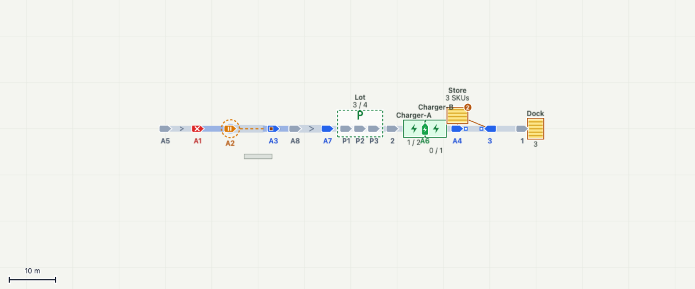

# The Studio map

Studio draws the scene of an intralogistics recording as a map: the floor to scale, one sprite for each kind of element, and three levels of detail. Everything it shows is read from the state recorded at the cursor, so a seek into the middle of a wait shows that wait without playing through its start. This page says how to read the map and how to give a model the sizes and positions that make the map accurate. For opening a recording, exporting and the other panels, see [Studio](../development/studio.md).

The map needs a recording written by this version of a model that declares a transport network. Recordings of production-only models and of earlier versions are still drawn as before (see [Older recordings and production models](#older-recordings-and-production-models)).

## The floor

The floor is drawn to scale, in metres.

- **Lanes** are strips along the arcs of the network, centred on the straight line between the two nodes. The two directions between the same pair of nodes make one strip. A one-way strip carries chevrons along its direction; a strip travelled both ways carries none when zoomed out and one pair at its ends when zoomed in. A disabled arc is not drawn.
- **Lane width is nominal.** The layout does not declare a lane width. The map draws a lane as wide as the widest vehicle of the recording plus a margin of 20 % of that width on each side, and twice as wide where the arc allows passing. It is a drawing aid, not a clearance: a real aisle may be much wider than its vehicles, and the simulation does not read it. The scene legend says so. A recording without sized vehicles draws lanes 1 m wide.
- **Zoomed out**, vehicles and facilities are symbols of a fixed size in pixels, so a lane would be thinner than them. A strip is therefore never drawn thinner than 10 pixels while the map is at symbol level. Zoomed in, it has its metric width.
- **The scale bar** at the bottom left shows a round length in metres (1, 2 or 5 times a power of ten, at most 150 pixels long) for the current zoom. It is part of the scene, so PNG and video exports include it.

Nodes of the network are hidden while zoomed out, except the selected one, and are drawn as small circles with their ids when zoomed in. A node bound to a warehouse is drawn as its bay.

## Sprites



The picture is a hand-built row of elements, not the output of a simulation. From the left: vehicle A5 idle, A1 stranded, A2 waiting (amber, with its dashed ring and wait line), A3 moving with a load, A8 in a state the map does not know, A7 moving; the parking area `Lot` holding three idle vehicles, fanned out; the charging stations `Charger-A` and `Charger-B` with A6 charging; A4 working at a bay; the warehouses `Store`, with the badge of two waiting orders and a line to its bay, and `Dock`. Three vehicles at the right have labels too long for the map, so it shows the trailing digits of their ids (1, 2 and 3). The scale bar is at the bottom left.

**Vehicle.** A rounded body with a pointed nose toward its heading: the direction of the arc under way, else the recorded heading, else east. At true size the body is the vehicle's footprint. A vehicle is drawn in the first of these states that applies, and each state has a mark as well as a colour:

| Shown | Recorded condition | Colour | Mark |
|---|---|---|---|
| stranded | `STRANDED` | red | cross |
| waiting for traffic | the `wait` field is set | amber | pause bars and a dashed ring |
| moving | `motion` is set | blue | none |
| working | `WAITING_LOAD` or `WAITING_UNLOAD` | blue | a small square on the bay side |
| idle | `IDLE` | grey | none |
| charging | `CHARGING` | green | bolt |
| at rest | any other `TRAVELING_*` | blue | none |

A state the map does not know is drawn grey, and the click detail names it. A vehicle with a load carries a brown square on its deck in every state. When the recording has several fleets, each vehicle has a stripe at its tail in the colour of its fleet (fleets in id order); with one fleet there is no stripe.

**Warehouse.** A rectangle with a shelf pattern, its name above and its stock below: the quantity when it holds one SKU, otherwise the number of SKUs. A small white square marks each bay it is bound to, joined to the rectangle by a thin line when they do not touch. A count in a circle at its corner is the number of orders waiting at it (status `PENDING`).

**Parking area.** A dashed outline with a "P" and the count `slots held / capacity`. The slots held include vehicles still on their way to the area. Vehicles are drawn where they stand, not in slots.

**Charging station.** A filled outline with a bolt and the count `slots in use / slots`.

**Reserved shapes.** Racks, staging areas and docks are not drawn in this release. Their shapes are reserved so that later work does not clash with the sprites above: a rack is a narrow rectangle with cross bars, a staging area a dotted outline with floor positions, and a dock a three-sided bracket on the edge of a building.

**Everything else.** Servers, the pre-shop pool, jobs and kinds the map does not know are drawn as before. Orders and fleets have no place on the floor and are not drawn; they appear in the Overview panel and in the detail.

## Three levels of detail

1. **The map** carries very little text: facility names and their counts, and a short label for each vehicle. At symbol level the short label is the vehicle's label when it has at most four characters, otherwise the trailing digits of its id.
2. **The Overview panel** says a little more, one line for each element.
3. **The click detail** says everything about one element.

Whether vehicles and facilities are symbols or true-size shapes depends on one number, the zoom in pixels per metre. True size begins at the zoom where the longest vehicle is as long as its symbol (22 pixels), so a symbol never changes size at the switch. For the corridor example, whose vehicles are 1.2 m long, that is about 18 pixels per metre. At true size a vehicle also has a one-line label, `<label> · <what>`, where `<what>` is the first of: `waiting <n> s for <first blocker>`, `charging`, `stranded`, `to <destination>` (a vehicle at rest with a route), `idle`.

Symbols of vehicles at the same position, in a parking area or on a node with capacity above one, are spread sideways by a fixed number of pixels at symbol level. At true size they are drawn where they are, and two vehicles at the same position overlap.

### The Overview panel

The panel is docked with the Inspector. It is built from the same data as the map, so the two cannot disagree. While playing it refreshes at most four times a second, and at once on pause, step and seek. It has four sections.

- **Vehicles**, grouped by fleet. A group heading counts its vehicles by state: moving, waiting, working, idle, charging, stranded and stopped (a vehicle at rest on a travel). Each line has the state mark, the vehicle's label, its load and destination, and what it is doing, for example `AGV-1 · loaded, 1 crate → East · waiting 6 s for AGV-2`. Stranded vehicles come first, then the waiting ones by longest wait, then the rest by id. A text filter and a **Waiting only** switch narrow the list. A group shows at most 200 lines and says how many are hidden.
- **Goods.** The open orders by status, and one line for each: quantity, SKU, origin, destination, vehicle and whether it was picked. At most 200 lines, oldest first. An order that has ended (`COMPLETED`, `FAILED` or `CANCELLED`) is not open, even while it is still in the recorded state.
- **Traffic.** The vehicles waiting now and the longest current wait; the waits, stuck waits and deadlocks counted so far, summed over the fleets. A recording without these counters shows only the first two.
- **Facilities.** One line each: the stock for a warehouse, the occupancy for a parking area or a charging station.

A click on a line selects the element and centres the map on it. Vehicles and facilities are named by their labels. Without a map the panel says "No map for this trace".

### The click detail

Selecting an element on the map, in the Overview panel or in the Inspector's entity list fills the Inspector with a readable description first. The raw recorded fields stay below it, collapsed. Names in the description are buttons that select the element they name.

- **Vehicle:** label, fleet and state; load and order; the node it is at or the arc it is on, its heading if it is known, its speed; its battery, with a percentage when the capacity is recorded; its route, with the next node in brackets; its wait (since when, for how long, the node it wants, the resources it needs and its blockers); what it holds; and its size, taken from its type.
- **Order:** each field in a sentence, and its vehicle.
- **Warehouse, parking area, charging station:** contents or occupancy, the nodes it is bound to, the vehicles at it and the open orders from and to it.
- **Node, segment, zone:** who holds it, who stands on it, its capacity, and for a zone its members and orientation. Segments and zones are selected from the Inspector's list or from a vehicle's detail, not by clicking the floor.

Every other kind of entity keeps the Inspector it had.

## Traffic on the map

With `ReservationController` the map shows what is held and who waits.

- **Held floor.** A node with a holder, a segment held in either direction, and every member of a zone with a holder are tinted in one translucent blue over the floor. Without `ReservationController` there are no such entities and nothing is tinted.
- **Wait line.** A dashed amber line joins each vehicle shown as waiting to the first of its blockers that is in the frame. The blockers are those known when the wait started: the simulation announces a wait once, and does not update its blockers when they change. A cycle of wait lines is how a deadlock looks. Deadlocks and stuck waits are counted in the Overview panel and are not drawn.

## Selection

Selecting a vehicle tints the floor it holds in a stronger blue, draws its route from its position to its destination (the part already travelled is left out), makes its wait line thicker, and draws the line of its order from origin to destination. These are drawn below the vehicles, so that a route never hides the vehicle ahead. The line of an order is a curved arrow, so that it does not lie on the corridor it follows.

Selecting an order draws that arrow and highlights the vehicle assigned to it. Selecting a facility highlights its bays and the vehicles bound for it. Selecting a lane, a node or a corridor tints it.

## Older recordings and production models

- A recording with no layout, written by a version before 0.18, has no map. Its entities keep the labelled fallback grid and the drawing they had.
- A recording with a layout and no network, which is a production-only model, is drawn as before, with the scale bar added.
- A recording with a network that lacks the fields this version records (`wait`, `route`, the capacities, the fleets' counters, vehicle sizes) still draws the map. Facilities sit in the layout's grid, joined to their bays by a line, vehicles are 1 m by 1 m, no vehicle is shown as waiting and the Traffic section shows only what it has.
- The layout editor keeps its own glyphs.
- HTML export and the offline player draw the same map and show the readable detail of a selection. They have no Overview panel. Video and PNG export have no camera: the export fits the scene, and whether it draws symbols or true size follows the fitted zoom.

## Giving the map sizes and positions

### A vehicle's size

Set `length` and, optionally, `width` on the vehicle type:

```python
cart = AGVType(
    name="cart",
    speed_profile=TrapezoidalProfile(max_speed=1.5, acceleration=0.5, deceleration=0.5),
    battery_capacity=1000.0,
    weight_capacity=10.0,
    volume_capacity=1.0,
    length=1.2,  # metres along the heading; also read by ReservationController
    width=0.6,  # metres across it; keyword-only; descriptive
)
```

`width` is keyword-only. The simulation reads `length` and `min_gap` under `ReservationController`, and ignores `width`. The map uses both: they are the vehicle's footprint, written to the layout and to the recording. A length of 0 or `None` means the size is not declared, and the vehicle keeps the default footprint of 1 m by 1 m. A width of 0 or `None` with a positive length gives half the length. A footprint you place yourself with `layout.place(agv, footprint=...)` wins over the type's size. Lane width follows the widest vehicle (see [The floor](#the-floor)).

### A facility's position and footprint

A warehouse, a parking area or a charging station with no explicit position is placed by the layout at the node it serves:

- A warehouse is placed beside its first input bay (its first output bay when it has no input bay). The direction is away from the network: opposite to the mean direction of the neighbours of that node, or towards +y when they cancel. The warehouse is moved along that direction by half its extent plus 1 m, so that it does not cover the lane.
- A parking area or a charging station is centred on its node, with a default footprint of 3 m by 3 m.
- A warehouse that would overlap an explicit placement, or a warehouse placed before it, is moved further along its direction until it does not. Warehouses are processed in id order. The automatic grid then avoids all of these.
- A facility with no node binding keeps the grid placement, as every production kind does.

A warehouse with several bays is joined to the other bays by a line. The default footprint of a warehouse is 1 m by 1 m; at symbol level it is drawn at the fixed symbol size, so an undeclared size does not make it invisible.

To control the place or the size, declare them. The explicit value wins, and the facility is not moved:

```python
from simulatte.layout import Footprint, Point

layout.place(store, position=Point(-6, 4), footprint=Footprint(8, 4))
layout.place(parking, footprint=Footprint(6, 4))  # the position still follows the node
```

Known limits of the rule:

- Inside a lattice the neighbours of a node cancel, and a warehouse goes to +y of its node, where it can cover part of the next lane. The 100-vehicle bench workload shows it. An explicit position fixes it.
- A warehouse and a charging station on the same node overlap by 0.5 m with these numbers.
- A warehouse whose output bay is far from its first input bay is joined to it by a long line across the floor.

## Known limits

- The frame time at 1,000 vehicles is above the budget of 16.7 ms: about 22 ms at the 95th percentile of the scene's own work, measured in Chromium with a GPU on an Apple M4 Pro. The 100-vehicle workload is inside it, at about 5 ms. The 1,000-vehicle figure is accepted as a limit of this release.
- Lane width is nominal.
- A vehicle moves on the straight line between two node positions, as before.
- A wait line goes to the blockers known when the wait started.
- At 100 vehicles the labels of vehicles that wait close together overlap; the Overview panel carries their text.
