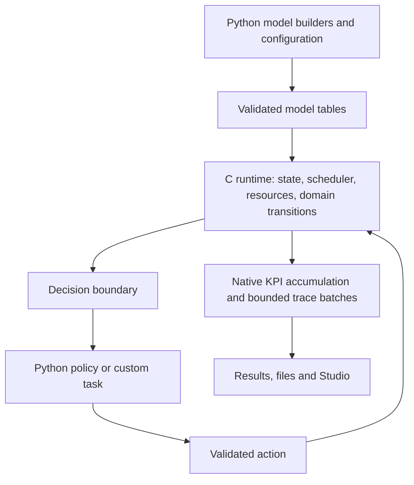

# Native simulation engine: feasibility assessment

Date: 2026-10-15. Base: `d3e17e6845e75163be34d583eac4417ee5d67290` (Simulatte 0.17.0).
Branch: `feature/native-engine-feasibility`.
Worktree on bigboss: `/Users/davide/.codex/worktrees/aee0/simulatte`.

Status: investigation and proposed direction, not an approved implementation specification.
No C engine or product change has been implemented. Native speedups remain unmeasured.

## Intent and recommendation

Davide proposed removing SimPy and rebuilding Simulatte's simulation API and primitives in C for a major
version. All breaking changes are allowed, with no backward-compatibility requirement. He chose **Python
authoring, native built-ins, and Python extension hooks** as the desired modeling experience.

This is technically feasible. The recommended design is a Python modeling layer over a C runtime that owns
the event calendar, state, resource allocation, and common production/intralogistics transitions. Python
policies enter at explicit decision points. The runtime should execute many transitions between Python calls.
The project is a runtime redesign plus domain-model ports, not just a dependency substitution.

Replacing only SimPy's event loop would leave substantial Python work in every operation. Moving arbitrary
Python generators behind a C scheduler would still execute their bodies in Python. On the measured CPython,
`heapq.heappush` already comes from `_heapq`; a C heap by itself is especially unlikely to justify this rewrite.
The installed SimPy 4.1.2 core schedules `(time, priority, sequence, event)` tuples and dispatches Python callbacks.

## Fresh evidence

Measurements use Apple M4 Pro, 12 cores, CPython 3.14.3, SimPy 4.1.2. The runtime reports macOS 27.0.1;
that is the measured platform string, rather than the older machine description in session instructions.
One process, one warm-up and five timed repetitions per case, run serially. Each existing feeder times
environment/model construction, simulation, and close/trace flush; input JSON loading and final trajectory
hashing are outside that timed interval. These are local diagnostic measurements, not a calibrated CI gate.

| Workload | No domain subscribers | KPI recording | Full recording |
|---|---:|---:|---:|
| 10-server LumsCor, 5,000 jobs, utilization 0.90 | 0.477 s | 1.725 s | 2.273 s |
| Same setup, utilization 0.95, independent committed input | 0.522 s | not measured | not measured |
| Intralogistics, 20 AGVs, 2 shifts | 0.393 s | 0.936 s | 1.257 s |

The first job shop processes 202,013 scheduler events. Intralogistics processes 54,328 scheduler events and
submits 2,089 orders, of which 2,078 complete by the fixed horizon; the remaining 11 are in flight. It uses the
existing benchmark's round-robin dispatch and default traffic configuration, so these results do not characterize
all congestion, deadlock, recovery, or custom-policy workloads. The job-shop feeder uses pre-generated input
and bypasses the router and runtime sampling.

The modes have the meanings defined in [benchmarks/README.md](../../benchmarks/README.md). In particular,
KPI recording currently also enables the semantic digest; it is not simply a cheap native counter baseline.
Full recording is approximately 4.77 times the unobserved job-shop time and 3.20 times the intralogistics time.

One additional cProfile run per case, separate from the timings, attributes **exclusive/self time** as follows:

| Workload and mode | SimPy Python functions | Native heap functions, all callers |
|---|---:|---:|
| Job shop u90, none | 28.5% | 2.5% |
| Job shop u90, KPI | 11.5% | 1.0% |
| Job shop u90, full | 9.0% | 0.8% |
| Job shop u95, none | 26.9% | 2.4% |
| Intralogistics, none | 8.7% | 2.6% |
| Intralogistics, KPI | 5.3% | 1.3% |
| Intralogistics, full | 4.2% | 1.1% |

These shares are diagnostic, **not an Amdahl estimate or a native speedup forecast**. Profiling changes costs
substantially, includes the complete feeder call (including GC and trajectory extraction), and observes only
the calling thread, not the writer thread's execution. SimPy attribution excludes callees elsewhere, allocations
attributed to callers, and native built-ins. Heap attribution also includes pathfinding. Percentages from
cumulative stack timings must not be added: a SimPy `step()` encloses much of the entire simulation.

Specific hotspots support a wider runtime boundary:

- In the unobserved u90 shop, `planned_slack_time_at` is 8.9% of profiled self time and
  `server_processing_times` is 6.4%. Priority calculations repeatedly inspect Python job/routing state.
- In unobserved intralogistics, path planning is 15.7%, generated `__hash__` functions are 8.2%, and
  `_wire.freeze` is 6.9%. Compact graph indices and reducing repeated object construction matter.
- In the full shop, digest handling is 12.2%, delta application 7.8%, and the writer's event handler 5.7%,
  before including their callees. A Python object/dictionary pipeline per native transition would constrain
  the gains from a faster kernel.

[Measurement script](native-engine-data/measure.py) and [raw results](native-engine-data/measurements.json)
include samples, input hashes, trajectories, profile functions, interpreter and hardware provenance. All
repeated and profiled runs matched their reference results; trajectories matched across recording modes,
and KPI/full semantic digests matched within each workload.

## Current coupling and rewrite scope

Thirteen source files directly import SimPy, including imports used only for typing. Inherited APIs spread
the dependency further; counting imports substantially understates the scope.

| Area | Evidence and required work |
|---|---|
| Environment and execution | [`environment.py`](../../src/simulatte/environment.py) subclasses SimPy and reads its time/queue. [`stopping.py`](../../src/simulatte/stopping.py) constructs private event state, schedules boundary priorities, inspects the queue, and calls `step()` in a Python loop. Both must move to a native run/control contract. |
| Production | [`server.py`](../../src/simulatte/server.py) subclasses `PriorityResource` and overrides `_trigger_put`; [`shopfloor.py`](../../src/simulatte/shopfloor.py) runs one generator per job with sync/generator hooks. Rewrite allocation and operation lifecycle as native transitions. |
| Policies | [`draco.py`](../../src/simulatte/policies/draco.py) explicitly depends on urgent process initialization running before normal release events. Replace this with a defined decision-before-grant phase. Preserve intended policy mathematics; assess deliberate semantic changes separately. |
| Inventory and capacity | [`_resources.py`](../../src/simulatte/intralogistics/_resources.py) overrides resource/container internals to observe mutations at the correct instant. Make inventory changes, grants, and their observations native atomic transitions. |
| Intralogistics | [`fleet.py`](../../src/simulatte/intralogistics/fleet.py), traffic, parking, warehouses and charging use processes, requests, timeouts and interrupts. Native mission states must handle cancellation before/after grants, cargo ownership, traffic waits, battery depletion and recovery. Pathfinding is part of the performance scope. |
| Observation and reproducibility | Events, deltas, state projection, digest, RNG, KPIs and trace writing need a native representation or efficient batch boundary. Merely wrapping their existing per-event Python APIs preserves much of their cost. |
| Packaging and remote execution | [`snapshot.py`](../../src/simulatte/execution/snapshot.py) freezes the runtime and a pure-Python supervisor import closure containing SimPy. Platform-specific extensions cannot simply be shipped from macOS to Linux. Runtime identities and provisioning must include target artifacts and engine version. |
| Browser examples | [`pyodide-worker.js`](../../docs/assets/javascripts/pyodide-worker.js) installs the current wheel into Pyodide. Native code needs a matching WebAssembly wheel/build or an explicit change to this feature. |

The experiment definitions, replication-level statistics, much of Studio's UI/playback, layout editing, and
high-level policy mathematics can be reused conceptually and often in code. Their adapters, schemas, handles
and integration tests will change. The existing trace format is also a choice: retaining a useful wire format
can avoid unnecessary viewer work without committing to compatibility with old Python APIs. Version it if
the new semantic model requires changes; do not preserve legacy internals solely to reproduce old bytes.

## Approaches considered

| Approach | Benefits | Limits | Assessment |
|---|---|---|---|
| Native scheduler with Python event/process/model objects | Smallest experiment; retains familiar arbitrary Python generators | Repeated Python callbacks, object allocation, policy work and observation remain; limited evidence for a large application speedup | Useful experimental control, weak destination for this major rewrite |
| Native runtime and domain built-ins, Python builders and explicit policy hooks | Native state and common transitions; extensibility for research; room for native KPIs and trace batches | Larger implementation; hook-heavy models remain constrained by Python; explicit ownership/lifetime contracts needed | Recommended; matches Davide's choice |
| Restricted model language or compiler for user model code | More user logic can execute natively | Compiler, diagnostics and restricted semantics become a separate major product; arbitrary Python cannot transparently compile | Defer; no requirement for this in the initial redesign |

## Proposed runtime boundary

Python model construction produces validated runtime tables: entity definitions, routes, graph edges,
distributions, capacities, policy identifiers and registered extension hooks. This is lowering a model into
data; it does not require a Python compiler or a new user language.



The C library should own its data independently of CPython: compact records, numeric IDs, an event calendar,
native resource/inventory queues, and explicit job/AGV state machines. Use a binary heap initially; measure
calendar alternatives before adding them. Stable handles with generation checks can prevent stale Python
references from accessing recycled storage. Python wrappers should expose views/queries and validated commands,
not writable mirrors of the same native state.

A thin Python extension binds that library. Handwritten C or generated C bindings are implementation choices
to measure in the prototype; neither justifies putting Python object manipulation back into every transition.
Keep the native library boundary independent of the binding tool. Per-platform wheels and an sdist with native
sources become release requirements. Evaluate the Limited API against actual binding needs rather than
assuming an `abi3` build covers every interpreter and free-threaded configuration.

Built-in FIFO/EDD/SPT-style policies, supported distributions, resource transitions and standard production flow
should not call Python per event. More complex built-in research policies can move incrementally, retaining
clear tests for their definitions. Select a suitable queue algorithm per policy: a dynamic policy whose scores
depend on global state cannot safely reuse stale heap keys just because a heap is available.

For a custom dispatch policy, expose one decision context with candidate arrays and return the chosen entity
handle or a structured action. This avoids one Python callback per candidate where possible. A Python hook
that does substantial work at every dispatch can still dominate runtime; publish this separately in benchmarks.
Do not reorder or batch dependent decisions across causality boundaries to reduce callback counts.

A Python custom-task/generator adapter can remain an extension path for behaviors outside the built-ins.
Its yields would use Simulatte-owned primitives and enter the same native scheduler. Native built-ins would
not be implemented through that adapter. Whether this adapter belongs in the first release is still open.

Support a `run_until_decision`/resume boundary for RL or external controllers, as well as horizon and population
stopping. Python exceptions should become a failed run with useful model context; invalid handles/actions must
be rejected before corrupting native state. Native errors require structured propagation and reliable cleanup.

On ordinary GIL-enabled CPython, Python callbacks require the GIL. It can be released while independent native
work runs without Python objects; that does not make callbacks free or parallelize a causally ordered event
stream. Start with one sequential runtime per replication and existing process-level replication parallelism.
Independent native replicas could later use threads after ownership and callback behavior are proven.
[Python's thread-state documentation](https://docs.python.org/3.14/c-api/threads.html) describes this boundary.

## Semantics and engineering work that cannot be skipped

1. **Define the new simulation contract.** Same-time ordering, initialization, cancellation versus grant,
   immediate completion, wait-any/all, exception propagation, resource release, horizon inclusivity, finite
   population drain, and zero-time livelock need explicit semantics. Double-precision time is a reasonable
   initial proposal, with finite/monotone scheduling validation; integer ticks require a deliberate resolution
   decision. Do not let implementation details decide scientific behavior accidentally.
2. **Own mutations and observations together.** Change state, assign a deterministic sequence, update native
   KPI accumulators, and append interested observation records at the transition boundary. Batch transport,
   encoding and disk writes without changing logical order. Full tracing must have bounded buffers and
   backpressure. Debug observers and full/KPI/off modes must not change scheduling, decisions or RNG draws.
3. **Version reproducibility.** Native RNG algorithms, named-stream derivation, distribution transforms,
   engine semantics and build identity must be recorded. A new seed-to-trajectory mapping is allowed; internal
   reproducibility is still required. Cross-platform bitwise reproducibility needs explicit control of floating
   point and math functions and actual cross-platform verification; C alone does not provide it.
4. **Make control a native boundary.** Per-event Python `step()`/control calls would defeat the fast path.
   Run bounded batches with cancellation, progress, trace flush and Python signal checks at safe points, with
   a wall-clock responsiveness target. Preserve consistent state on stop and failure.
5. **Redesign remote runtime delivery.** Separate the portable supervisor import closure from the native model
   engine. Resolve/build the correct artifact for worker OS, architecture, Python ABI and engine version,
   verify hashes, and include it in immutable cache/provenance identities. A locally built editable extension
   needs a deliberate remote-build/artifact policy; transferring that binary is insufficient.
6. **Budget platform support.** macOS, Linux, Windows and relevant ARM machines need native wheel tests;
   PyPy, free-threaded CPython and browser execution need explicit support decisions. Browser execution is
   feasible with WebAssembly builds. [cibuildwheel](https://cibuildwheel.pypa.io/en/stable/) supports building
   and testing native wheels across multiple platforms, including Pyodide targets; this does not validate
   Simulatte's extension or the currently pinned browser runtime automatically.
7. **Validate native memory and scientific behavior.** Sanitizers, fuzzed event/resource operation sequences,
   lifecycle/ownership tests and wheel-installed tests supplement Python tests. Use hand-computable schedules,
   conservation laws, policy examples and exact deterministic input tapes. Compare old/new trajectories where
   semantics are deliberately equivalent; explicitly specify changed outcomes elsewhere. Old digests are
   not a compatibility requirement. Statistical checks are additional evidence, not a substitute for exact
   event-level tests.

## Proposed first milestone and effort

Before committing to a full port, build a **small vertical prototype**: a native event calendar, resource
allocation, job routes, a built-in dispatch rule, and one Python policy hook. Include native KPI accumulation
and a minimal ordered trace output with a validating reader. Compare a scheduler-only variant against the
native-transition variant to isolate the value of the wider boundary.

Measure the same deterministic workload with no recording, KPIs, and full recording; separate pure native,
custom-policy and custom-task modes. Include build/run/close, memory, event counts and Python crossing counts.
Use the committed 5,000-job workloads plus longer runs in fresh processes. Add a small graph/AGV slice before
extrapolating the production result to intralogistics. Keep trace/compression and semantic work equivalent
when reporting speedups. Benchmark optimized Python/PyPy baselines too, before claiming a C-specific benefit.

A proposed commercial/maintenance justification gate is at least **3x end-to-end throughput on representative
built-in production workloads**, with meaningful measured improvement under full recording (for example 2x),
and acceptable custom-hook cost. These numbers are proposed decision criteria, not achieved results, forecasts,
or user-approved requirements. Microbenchmark wins alone should not green-light the whole rewrite.

Order-of-magnitude planning estimates for one experienced engineer working substantially full-time:

| Deliverable | Indicative effort |
|---|---:|
| Vertical prototype and decision evidence | 1–2 weeks |
| Runtime semantics, primitives, bindings and initial packaging | 4–8 additional weeks |
| Production/policy and intralogistics ports | 6–12 additional weeks |
| Observation, remote/browser integration, validation and release hardening | 4–8 additional weeks |

Some work overlaps; a feature-complete major release is approximately **4–8 engineer-months**, with the
largest uncertainties in custom behaviors, intralogistics cancellation/recovery, reproducibility, and the
platform matrix. A narrower first release can be earlier. These are judgment estimates, not a delivery promise.

Open decisions: target speedup and workload mix; custom-task support in the first version; new time/ordering
contract; platform and browser support; trace schema scope; reproducibility guarantee across architectures.
The next concrete engineering decision should follow the vertical prototype, not a wholesale mechanical port.

## Verification and reproduction

Setup: `uv sync --dev --all-extras` completed in the dedicated worktree. Targeted current-engine baseline:

```sh
.venv/bin/python -m pytest -o addopts='' \
  tests/core/test_invariance.py tests/core/test_server.py tests/core/test_server_events.py \
  tests/core/test_shopfloor.py tests/core/test_stopping.py \
  tests/intralogistics/test_invariance.py tests/intralogistics/test_traffic.py \
  tests/intralogistics/test_parking.py tests/intralogistics/test_warehouse.py \
  tests/intralogistics/test_fleet_events.py -q
```

Result: **202 passed in 6.49 s**. This is a targeted baseline, not the full suite or the 99% coverage gate.
No runtime code changed, and no native behavior has been verified.

```sh
.venv/bin/python specs/research/native-engine-data/measure.py
.venv/bin/ruff check specs/research/native-engine-data/measure.py
.venv/bin/ruff format --check specs/research/native-engine-data/measure.py
git diff --check
```

The measurement script overwrites `measurements.json`. The retained measurements come from the corrected
profile grouping: module names are resolved after the last `/simulatte/` path component, so a worktree directory
named `simulatte` is not mistaken for the package. An earlier diagnostic run exposed that grouping error and
was replaced by a complete rerun; it did not alter the workloads or product code.
