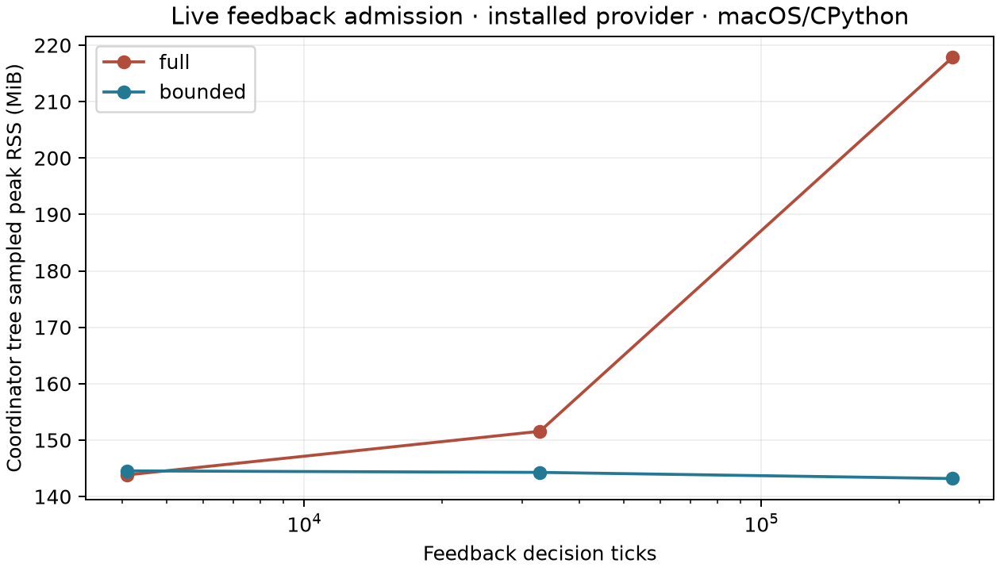

# Feedback-driven admission with bounded native retention

2026-11-03. The installed experimental provider passes this feedback/admission
gate against ordinary Python production actors. No production, provider, C or
public API change was needed. The new experiment starts from signed
`d26edb967b9bfc2eab7357910e0c1efbe056dcb5`; prior source and evidence stay unchanged.
Native remains v3 research after successful v2/Studio, with release work deferred.

## Model and contract

A standalone Python controller reads live job state and all eight windowed
`ShopFloorKPIs`. At each half-unit boundary it removes completed handles, then
admits at most three jobs subject to a hard outstanding-work cap. A tardy fraction
above 0.35 halves the admission target; pool state selects normal jobs or shorter
reversed routes. The controller therefore changes actual input timing and content
from live observations. ConWIP separately caps released floor work.

The normal cap is 12 owned handles, the tight target 6 and the floor cap 4. The
second correctness configuration uses hard cap 8 and floor cap 2. Candidates are
derived from a counter seed and constructed only after credit is available.
There is no pre-generated workload, completed-job collection or decision list.
Current live identities/arrival/due data, source seed/cursor, phase, next wake,
configuration and rolling commitments enter the pure native `input_state` callback.

Wake events use the same urgent triggered-Event pattern as managed Horizon
boundaries: inspect state strictly before ordinary events at that timestamp.
Ordinary timeouts do not guarantee that ordering. A constructed tied-completion
test distinguishes the two orderings. Final controller state is also committed
through a typed domain event before Horizon finalization.

The ordinary Python reference uses `ProductionJob`, `ShopFloor`, `PreShopPool`,
ConWIP, FIFO/SPT dispatch and `ShopFloorKPIs`. It has its own live-actor inspection;
it does not reuse native observations. Completed handles are normalized to a
completion identity, since bounded mode deliberately cannot inspect their old
release/finish timestamps. Live observations retain release times and state.
This proves the observations used by the control law, not full historical
trajectories from the bounded API.

## Correctness and reproduction

The main installed gate runs **42 two-slot cases across 14 physical scenarios**:
ordinary Python/full native/bounded native, FIFO/SPT, two caps, paired seeds,
partial 17.25 Horizon with warmup 2, 80 Horizon with warmup 10, early 0.25 and tied
1.0 boundaries, and feedback-disabled counterfactuals. Every observation,
completion detection, decision, constructed input and eight live/final KPI values
matches across the three engines. There are **1,423 compared decision boundaries
per engine**. Deduplication yields 13 unique streamed proofs with 1,388 rows,
independently audited against the control law and counter-source arithmetic.

Proof rows stream to deterministic gzip on disk; final artifacts contain rolling
commitments and bounded current state. The audit rejects altered choices,
constructed job durations and completion observations. Removing feedback changes
actual admitted work, rather than only diagnostics: the seed-100 SPT 80-unit case
admits 122 jobs with feedback (68 short/54 normal, 74 blocked polls), versus 81
normal jobs without feedback. This is a causal-control fixture, not evidence
that a release policy is better: job requirements intentionally differ.

Twelve source-deleted fresh-process reproductions preserve exact ordinary
fingerprints, proof/artifact hashes, native state and physical summaries. Two
additional same-parent memory reproductions do likewise. The primary gate has
**77 distinct successful managed attempts**: 42 correctness, 12 reproductions,
21 memory/control cases and two repeated attempts. Fingerprints compare within
the corresponding backend/schema; physical proofs compare across engines.

The matching existing core/provider wheels are installed into a new copied-asset
venv outside the checkout. Core Python bytes and native source manifest are
checked against the frozen tree. Actual runtime: CPython 3.14.3, macOS 27.2 arm64.
Runtime PATH contains Git only, `CC` is invalid, and import auditing verifies
installed native origins and absence of prototype imports. The original source
file is deleted before reproduction from ordinary captured source.

## Memory and timing

Three paired seeds per size, full/bounded native, normal managed semantic digest,
KPI trace, artifact publication and all live controller observations remain active.
Memory cases keep rolling commitments without exporting proof rows. No tests or
compilers run concurrently with the final serial matrix. An external monitor
samples simultaneous Coordinator/descendant RSS every 40 ms. Child self peaks are
captured at backend close, after final state hashing and recorder closure; native
capacity diagnostics are captured at the final live boundary. These are separate
metrics; short allocation bursts can escape tree sampling.

Medians in MiB (admitted-job medians vary with the feedback decisions):

| Decision ticks | Admitted jobs | Full tree peak | Bounded tree peak | Full child self peak | Bounded child self peak |
|---:|---:|---:|---:|---:|---:|
| 4,096 | 3,070 | 143.83 | 144.55 | 46.13 | 45.91 |
| 32,768 | 24,230 | 151.56 | 144.28 | 53.44 | 45.78 |
| 262,144 | 193,863 | 217.88 | 143.19 | 120.77 | 45.52 |

With **64 times more decisions**, bounded child and whole-tree peaks stay flat.
At the largest size, the tree peak is about **34% lower** and child peak about
**62% lower**. Parent medians stay around 44–46 MiB in both modes. The same-parent
three-attempt self high-water checkpoints are about **46.59 → 48.80 → 48.94 MiB**;
fresh children remain near 45 MiB. This is a finite repetition check.

Across stable bounded cases, retained native capacity is **6,759–7,783 bytes**,
owned handles never exceed **12**, the callback state is at most **892 bytes**,
and the native environment has exactly two live entities. Expired-handle reads
equal the number of completed native jobs; none remain as controller history.
Full and bounded physical commitments and native event counts match by seed/size.
Extra pure queries preserve exact fingerprints and artifact hashes within a mode.

Largest-size end-to-end wall medians are **10.61 s full / 11.03 s bounded**, about
4% overhead for bounded retention in this controller-heavy workload. These include
cold preparation, Python observations/decisions/commitment work and publication.
There is no new native-versus-Python speed claim. The reference gates establish
physical equivalence; the large matrix measures native retention modes.

All predeclared acceptance limits pass: bounded child median range <16 MiB,
tree <24 MiB, parent <16 MiB, full child exceeds bounded by >16 MiB at the largest
size, <=12 handles, <8 KiB callback data and <128 KiB native retained capacity.

## Interpretation and limits

Backpressure is what keeps unfinished work bounded. Completion reclamation alone
cannot bound a growing input queue, pending templates, user history, or an
arbitrarily large advance batch. Counter/commitment state is compact for the
tested finite horizon; this is not an unconditional infinite-stream guarantee.

This fixture deliberately consumes the **reporting window's tardy fraction**.
A supplementary direct paired check keeps source, seed, horizon and caps fixed
while varying warmup 0/10: feedback admits 122 jobs in each case but changes the
admitted-input hash and tight-poll count (148/139). With feedback disabled,
the admitted-job hash remains identical. Warmup is therefore part of this
particular control law, rather than a passive reporting choice. Extra reads
remain passive and preserve results. This is model semantics, not an engine
mismatch; all compared engines share the same warmup and stopping policy.

For a production-oriented next fixture, keep job specifications fixed and use
controller-owned observations independent of reporting warmup. That would
isolate adaptive admission and permit a direct check that changing report
windows leaves input trajectories unchanged. This is a proposed next experiment,
not an adopted task or public API expansion.

This feedback gate is local macOS/CPython validation. The preceding Linux native
integration gate remains separate evidence; this report makes no new Linux
feedback, additional ABI, arbitrary actor/policy, cancellation/preemption or
production deployment claim.

## Verification and evidence

All **36 focused research tests pass**, covering 32 policy/cap/seed/horizon
combinations across all three engines, a constructed completion tie, feedback
counterfactual, future-callback commitment/purity and query invariance. Scoped
Ruff lint/format pass. Production sources are unchanged, so the previously passed
full root suites and sanitizer gates were not repeated. All **1,966 base-commit
files** remain byte-identical; no past raw evidence was rewritten.

Initial test assumptions were corrected before final measurement: seed 101 did
not cross the tardy threshold in one context, so branch coverage is required of
the designated seed-100 cases while exact parity remains required for both seeds.
The default-workload normal-timeout negative did not show divergence, so a
constructed tied completion tests that boundary requirement. Diagnostics were
moved to backend close. A README correction invalidated a draft through the
source-freeze guard; drafts stay ignored and are not relabeled as final data.

See the standalone model and runner in
[`prototypes/native_feedback_retention`](../../prototypes/native_feedback_retention/README.md),
raw results and [`audit.json`](../../prototypes/native_feedback_retention/results/gate/audit.json),
the frozen [`verification.json`](../../prototypes/native_feedback_retention/results/gate/verification.json),
and the outer [`validation.json`](../../prototypes/native_feedback_retention/results/validation.json).
The warmup check is reproducible after timing with
`python -m prototypes.native_feedback_retention.checks.warmup`.

The measured source SHA-256 is
`61dc136344d341b53473f971bb1e02626bf66313f4789f5bf2a1e1563cbaf497`.
The supplementary warmup check was added after measurement and is hashed
separately with the final evidence; it is not part of the timed model's source map.

No push, publication, release baseline selection or version change accompanies
this research. A signed local commit and Cortex checkpoint record completion.
