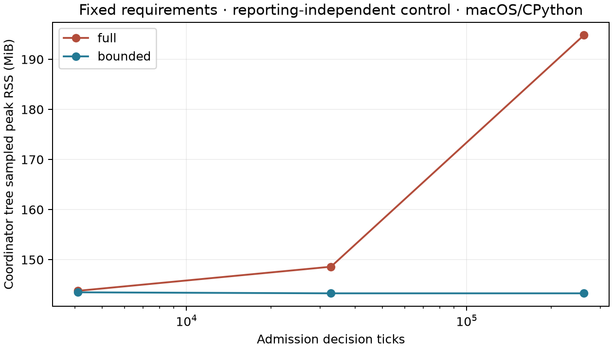

# Fixed specifications and reporting-independent admission

2026-11-03. This experiment passes on the installed experimental provider without
production, C, provider or public API changes. It starts at signed
`8501694ba04c80d3a0fa5af552c377ddaaac0f09` and preserves every earlier file.
Release sequencing remains Studio v2 first, native v3 afterward; deployment and
portable-release work remain deferred.

## What changed in the model

Routes, processing durations, nominal offered times and **absolute due dates**
are pure functions of source seed and job index. A lazy source offers 12 jobs
every 16 simulated units, spaced by 1/8 unit. A controller can postpone actual
plant entry, but cannot shorten a job, reroute it or move its deadline.

The controller owns its statistic from time zero, independent of any reporting
collector: a fixed-point EWMA of observed pool fraction,
`q = (q + floor(256 * pool / live)) // 2`, with zero instantaneous pressure for an
empty system. Hysteresis tightens at 64 and relaxes at 16. It admits at most three
eligible jobs per half-unit urgent right-open boundary, with hard cap 12, tight
cap 6 and separate ConWIP floor cap 4. A second context uses hard cap 8/floor 2.

There is no materialized future-template or pending-source queue. The seed/index
regenerates requirements on demand. Owned handles, pressure/mode, next wake,
phase/configuration and rolling specification/admission/control commitments enter
the pure callback. Reporting values and reporting hashes do not enter control
state. Proofs and final artifacts for control and reporting are separate.

External postponement is explicit: source-to-admission delay is accumulated in
exact eighth-units. Engine flow-time KPIs start at actual plant entry; absolute
deadlines still include the effect of external waiting in lateness. This avoids
moving deadlines or concealing delay by redefining requirements.

## Reporting-window invariance

The installed gate runs **60 correctness cases across 20 physical scenarios**:
ordinary Python production actors, full native and bounded native; FIFO/SPT;
paired seeds in the longer context; two caps; partial Horizon 33.25 with warmups
0/10; Horizon 96 with warmups 0/10/40; early/tied boundaries and a
feedback-disabled counterfactual. Every control observation, completion detection,
decision and admitted input matches across all three engines, along with all
eight reporting KPIs for each window.

There are **2,959 compared decision boundaries per engine**. Deduplicating identical
control streams across reporting windows gives 10 control proofs/1,289 audited
rows. The 20 reporting proofs remain separate. An independent audit reconstructs
the source arithmetic, absolute deadlines, EWMA/hysteresis, admission credit and
offer readiness. It rejects altered deadlines, pressure values and completion
observations.

Across all **18 engine/context/seed window groups**, the complete control artifact,
admitted-input trajectory and compressed control proof are byte-identical while
reporting KPI values change. In all six Python comparisons, the semantic digest
also remains identical: the ordinary domain-event trajectory is unchanged.
The larger memory cases repeat warmups 0/10/40 and preserve the same control data.

The feedback-disabled comparison now keeps work requirements fixed. For seed100/
SPT/H96, both variants admit the same 72 jobs and have the same specification
commitment. Admission commitments differ solely because of entry timing. The
controller switches mode 12 times, records 64 credit-blocked polls, and accumulates
91.5 source-wait units versus 28.5 without feedback. This demonstrates genuine
admission control, not policy superiority; no controller tuning or statistical
policy-quality study was performed.

## Fingerprint scope

The reporting-independent **control commitment** stays identical across windows.
The Python and full-native semantic digest components are also invariant in
their six multi-window groups. Reported KPI maps intentionally differ.

The bounded native opaque digest differs across windows in all six groups. Its
existing `NRST0001` representation commits the windowed KPI snapshot as well as
native history/live state and callback inputs. This is an existing encoding
property, not evidence of changed admission or physical behavior. The experiment
does not silently redefine that schema or claim whole-fingerprint equality across
windows. Within the same backend/window, reproduction matches the complete
fingerprint and all artifacts exactly.

This leaves a useful next contract experiment: distinguish trajectory/control
identity from window-dependent reporting state, with explicit, versioned semantics.
That is a proposal, not an adopted API change.

## Fresh processes and reproduction

Matching existing pure-core and native wheels are copied into a fresh external
venv. Core Python bytes and the native manifest match the frozen source tree.
Runtime PATH contains Git only, `CC` is invalid, and native import origins must be
installed `site-packages` with no prototype imports. Runtime is GIL-enabled
CPython 3.14.3 on macOS 27.2 arm64. Model source is captured as an ordinary
self-contained project file using public simulation operations and the existing
research lifecycle/boundary instrumentation pattern.

Fourteen fresh-process reproductions after deleting that source file preserve
exact fingerprints, control/reporting/native summaries and artifact hashes.
These include bounded warmup 0/40 requests. Two additional same-parent memory
reproductions also match exactly. There are **99 distinct successful managed
attempts** in the primary gate: 60 correctness +14 reproductions +23 memory/
query/window/repetition cases +2 extra attempts.

## Memory and elapsed time

The serial three-seed matrix retains normal semantic digest, KPI traces and
publication. Memory cases keep rolling commitments without exporting proof rows.
No tests, compilers or source edits run concurrently. An external monitor samples
simultaneous Coordinator/descendant RSS every 40 ms. The child captures its own
peak at backend close, after final state hashing and recorder closure. Individual
peaks and sampled simultaneous peaks are separate measurements.

Medians in MiB:

| Decision ticks | Admitted jobs | Full tree peak | Bounded tree peak | Full child peak | Bounded child peak |
|---:|---:|---:|---:|---:|---:|
| 4,096 | 1,536 | 143.78 | 143.48 | 45.84 | 45.52 |
| 32,768 | 12,288 | 148.59 | 143.28 | 50.67 | 45.36 |
| 262,144 | 98,304 | 194.84 | 143.28 | 96.20 | 45.42 |

With 64 times as many decisions/jobs, bounded memory stays flat. At the largest
size, sampled tree peak is about 26% lower and child peak about 53% lower. Parent
medians remain around 45 MiB. Same-parent self high-water checkpoints are
**44.83 → 45.20 → 45.36 MiB**, with fresh children around 45 MiB.

Observed owned handles never exceed 10 against the hard cap of 12; callback data
is at most **1,329 bytes**. Standard bounded cases retain **5,479 native bytes** at
the final boundary, including retained capacities; counters exclude temporary
scratch and allocator overhead. Full RSS includes actual allocation behavior.
Expired reads equal completed native jobs, unfinished native work matches the
final control observation, and full/bounded event counts match by seed/size.
Additional pure queries preserve exact within-window fingerprints/artifacts.

Largest-size wall medians are **9.88 s full / 10.48 s bounded**, about 6% overhead
for bounded retention in this polling/control fixture. These include preparation,
Python control/commitment work and publication. No new native-versus-Python or
cross-experiment speed comparison is claimed. Single-attempt trace files stay
about 57 kB and project/store about 16.07 MB across job counts; further attempts
still consume durable disk under the normal explicit retention policy.

All predeclared bounds pass: bounded median range child<16/tree<24/parent<16 MiB,
largest full child exceeds bounded by>16 MiB, owned<=12, callback<8 KiB and native
retained capacity<128 KiB. This bounds this finite fixture's owned state, not an
arbitrary real external backlog, user history or unbounded advance batch.

## Verification and evidence

All **25 focused tests pass**, including cross-engine/window parity, immutable
deadlines, changed timing with a common fixed-specification prefix, forbidden KPI
reads in control-only polls, poisoned reporting reads for all three engines,
callback completeness/purity and extra-query invariance. Scoped Ruff lint/format
pass. Product sources are unchanged, so previously passed full regression and
sanitizer gates were not repeated. All **2,048 base-commit files** remain unchanged.

See the [reproduction instructions](../../prototypes/native_fixed_admission/README.md),
[`audit.json`](../../prototypes/native_fixed_admission/results/gate/audit.json),
[`verification.json`](../../prototypes/native_fixed_admission/results/gate/verification.json)
and outer [`validation.json`](../../prototypes/native_fixed_admission/results/validation.json).
Measured source SHA-256:
`af0e11fac46cf1568df68d86118258dddb4d8d64e9e389a2dc12a4c98cb4b5cd`.
Raw deterministic gzip proofs, logs, manifests, metadata and plot are retained.

This is local macOS feedback validation, separate from the earlier Linux native
integration evidence. No new platform/ABI, general actor/policy, cancellation or
production-release claim follows. A signed local research commit and Cortex
checkpoint record completion; nothing is pushed or published.
