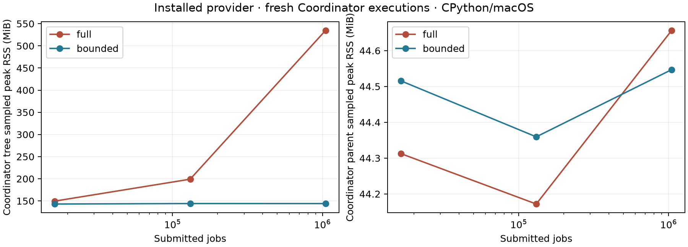

# Bounded retention in the installed experimental provider

2026-11-03. Local v3 research, after the successful v2/Studio release. This work
does not select deployment baselines or publish portable wheels. The implementation
starts at signed commit `b290a344a9f6e264530bb4aa39c2b37cfc9901ad`; the measured
source map identifies the integrated tree before its commit.

## Outcome and API

The experimental provider now supports `retention="bounded"` in both public
entry points. Full retention remains the default, including completed-job
inspection, full trajectories, `NSTA0001` and `native-production-v1`.

```python
from simulatte.experimental.native import Job, NativeStream

with NativeStream(servers=2, retention="bounded") as engine:
    for i in range(10_000):
        engine.add(Job(i * 3, (0, 1), (1, 1), due=i * 3 + 5))
        engine.advance((i + 1) * 3)
    engine.run()
    print(engine.snapshot()["scalars"])
    print(engine.storage_stats())
```

Managed models select the same option on `NativeProduction`. A lazy Python
producer must still provide the existing pure `input_state` callback covering
all future inputs/controller state, including its cursor and RNG state. An
eager `jobs` iterable is admitted immediately; the adapter releases its copied
Python references after admission, but all pending native jobs still cost memory.

Successful advance/run boundaries reclaim completed jobs and operations.
Owner-scoped 64-bit logical identities survive physical compaction; inspecting a
reclaimed handle raises public `ExpiredHandleError`. `result()` requires full
retention; `snapshot()` works in both modes. `storage_stats()` is detached
diagnostic data, available on a managed backend at live synchronized boundaries.

Bounded state is deliberately versioned separately: `NRST0001` wraps the rolling
SHA-256 completion-history commitment, logical `NBST0001` live state and canonical
KPI snapshot. Managed state declares `native-production-bounded-v1` and includes
the input callback. Physical results are compared across modes; whole-state
fingerprints are reproduced within a mode. These bytes commit state and do not
provide an engine restore API.

The matching local package pair remains `0.17.0`; provider API advances to 2.
An old companion produces an actionable rebuild/reinstall error before loading
native code. No package has been published or pushed by this experiment.

## Implementation and integrity

The installed provider contains ordinary linked translation units, not runtime
prototype imports or C-file inclusion. A shared private engine header exposes
storage to the retention module, while one event drain and the original event
transitions serve both modes. A C-only completion hook records a batch before
compaction; Python commits that batch to history. A failed mutating operation or
failed history update prevents further state publication.

The two-image layout remains the extension plus its namespaced engine library.
Both stock KPI paths retain the strict floating-point compilation unit with
`-ffp-contract=off`. The ten-file C/header manifest, ABI checks, wheel RECORD,
loaded-image origins and close-time byte verification apply to the integrated
provider. CI checks the integrated manifest rather than requiring every new
module to match the old five-file prototype.

The audit verifies all 12 original event/queue/calendar transition function bodies
unchanged, the original stock arithmetic prefix unchanged, and all 1,039 prior
tracked research/specification files unchanged. Historical experiment evidence
has not been rewritten.

## Installed reproduction gate

The matching core and provider were built through their source distributions,
then installed into a fresh external virtual environment with copied wheel
assets. The core wheel's Python sources and the provider's source manifest are
checked against the measured tree. The actual runtime was GIL-enabled CPython
3.14.3 on macOS 27.2 arm64. Build compiler: Apple Clang 21.0.0. Runtime PATH
contains Git only, `CC` is invalid, the current directory is outside the checkout,
and imported native code must come from installed `site-packages`.

The ordinary experiment/Coordinator path exercised:

- 16 successful two-slot runs: full/bounded, fixed/lazy admission, FIFO/SPT,
  two paired seeds, partial Horizon stopping and warmup.
- Eight fresh reproductions after deleting both project source files. Every
  attempt ID changed; fingerprints, deterministic summaries and artifact hashes
  matched exactly, using the normal captured-source path.
- 25 separate memory/control cases, plus two additional source-deleted
  reproductions in one long-lived Coordinator parent: 51 successful managed
  executions in the primary gate altogether, including ten reproductions.
- Extra pure KPI/state/storage queries in each mode preserved exact ordinary
  fingerprints and artifact hashes. Timing, RSS, capacities and PIDs remained
  external diagnostics and did not enter published semantic artifacts.
- A private installed-binary corruption caused an execution failure and zero
  published results. A separate existing clean-install gate rejected seven
  ABI/API/manifest/binary/dependency/runtime-mutation/wheel-tag negative cases.

The audit independently regenerated all 11 workload input hashes, checked exact
paired KPIs and event counts, and rejected deliberately corrupted input-hash and
admission-count evidence. Full and bounded schema fingerprints are never claimed
to be equal to one another.

## Memory and timing

The serial matrix uses three paired seeds at 16,384, 131,072 and 1,048,576 jobs,
three servers, SPT, ConWIP 12, lazy 64-job lookahead, arrival spacing 1.5 and the
ordinary semantic digest/KPI trace publication path. A host monitor samples the
Coordinator and descendant process tree every 40 ms. Each simulation child also
reports its own `ru_maxrss`, catching transient peaks between monitor samples.
The external monitor is outside the measured tree. Individual process peaks
cannot be summed to obtain the simultaneous tree peak.

Medians of three paired cold executions, in MiB:

| Submitted jobs | Full tree peak | Bounded tree peak | Full child self peak | Bounded child self peak | Bounded parent peak |
|---:|---:|---:|---:|---:|---:|
| 16,384 | 149.67 | 143.08 | 51.63 | 45.34 | 44.52 |
| 131,072 | 199.11 | 144.11 | 101.53 | 45.38 | 44.36 |
| 1,048,576 | 534.72 | 144.05 | 436.61 | 45.41 | 44.55 |

The 64-fold increase in submitted jobs adds less than 0.1 MiB to the bounded
child median. At the largest size, bounded retention reduces the sampled tree
peak by about 73% and the child self peak by about 90%. Parent memory is stable in
both modes; the difference is in simulation-child retention and state encoding.
The two-slot correctness gate is separate from this one-active-run memory table.

Bounded native retained capacities are 40,151–40,663 bytes across all stable
sizes: job capacity 128, operation capacity 256, calendar capacity 128, completion
buffer 16,384 bytes. At Horizon there are one or two live jobs, depending on seed;
all completed jobs are forgotten. The seed-100 million-job run has 17,404,544
native events in either mode, with exactly equal eight KPI values. Its full mode
retains 1,048,576 jobs / 3,145,728 operations and 244,322,799 native bytes. Native
capacity counters exclude transient compaction scratch and allocator overhead;
the RSS measurements include the actual process behavior.

The million-job end-to-end wall medians are 4.758 s full and 4.652 s bounded.
This three-seed, single-host experiment supports similar elapsed time, not a
new engine-speed claim. It includes cold Coordinator preparation and publication.

The same-parent three-attempt case has parent self high-water checkpoints
46.45 → 48.75 → 48.88 MiB, and fresh children remain near 45 MiB. This is a finite
repetition check, not evidence of zero parent growth indefinitely. Additional
queries preserve semantic results; bounded query-case child peak is 45.33 MiB,
while full mode reaches 191.55 MiB at 16,384 jobs versus its 51.63 MiB ordinary
median. Full historical state queries can have a significant memory high-water
cost even when their results do not alter simulation semantics.

The overloaded control (spacing 0.125) retains 14,086 unfinished jobs at 16,384
admissions and 56,354 at 65,536. Bounded child peak consequently rises from 62.05
to 105.84 MiB; tree peak rises from 160.77 to 205.67 MiB. Bounded mode can use
more memory than full in this regime because it also stores the logical-state
buffer and identity/history bookkeeping. It does not resolve an unstable queue.

Published KPI traces stay about 55.9 kB and each single-attempt project/store
about 16.05 MB across these workload sizes. The normal store is not secretly
accumulating completed native trajectories. Separate runs/reproductions still
create durable results and consume disk; this is not automatic store retention.



## Verification

- Root regression suite: **3,592 passed, one skipped**, three existing warnings;
  Python line/branch coverage **99.05%**, with the existing 99% gate unchanged.
- The 83 existing/new native Python cases pass at the ASan/UBSan-instrumented
  CPython binding boundary against the release engine library. Python leak
  detection is disabled for this run; it is not a leak-proofness claim.
- A separate fully instrumented canonical engine/retention/stock driver passes
  **164 full + 156 bounded allocation-failure positions**, read-only allocation
  failures, 10,000-job recycling and identity-overflow checks.
- Scoped Ruff lint/format, `ty check src`, `uv lock --check` and documentation
  build pass. A whole-repository formatter check has pre-existing research-file
  differences; those historical files remain untouched.
- Main and research worktrees, staged bytes, source/evidence hashes and commit
  signature are checked at completion. The new gate does not claim fresh Linux,
  other-ABI or remote-worker validation.

Reproduce the installed matrix from the research worktree with its built wheels:

```sh
.venv/bin/python -m prototypes.native_retention_integration.run \
  --core-wheel path/to/simulatte-0.17.0-py3-none-any.whl \
  --native-wheel path/to/simulatte_native-0.17.0-<matching-tag>.whl \
  --output path/to/new-output
.venv/bin/python -m prototypes.native_retention_integration.analysis \
  path/to/new-output --plot
```

Do not compile, run tests, or modify frozen sources concurrently with timing.
The runner records the retained external workspace, package hashes, exact source
map, actual runtime, compiler and per-case evidence. See
[`results/gate/audit.json`](../../prototypes/native_retention_integration/results/gate/audit.json),
[`results/gate/verification.json`](../../prototypes/native_retention_integration/results/gate/verification.json)
and the outer [`validation.json`](../../prototypes/native_retention_integration/results/validation.json).

## Limits and proposed next step

The memory claim is conditional on bounded live work, bounded lookahead/controller
state and sufficiently frequent advance boundaries. Buffer capacities retain their
high-water marks. ConWIP bounds released work and does not cap the pre-shop pool;
an overloaded arrival stream still grows. Retaining Python histories/handles or
admitting all future jobs eagerly defeats the whole-workload bound. The normal
KPI trace used here is compact; this result makes no full-native-trace claim.

There is no cancellation, preemption, arbitrary actor/policy translation,
intralogistics support or production deployment decision in this change.
The next proposed gate is the same installed bounded-retention/reproduction
validation on Linux, including its sanitizer boundary. That is a portability
experiment for the integrated modules, not selection of release-wheel baselines.
