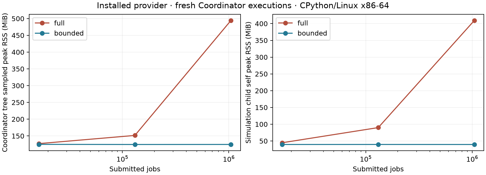

# Installed bounded-retention provider on Linux

2026-11-03. This is the Linux counterpart of the
[installed macOS integration gate](2026-11-03-native-retention-integration.md),
authorized by Davide after that result. Native remains v3 research following
successful v2/Studio. Portable-release baselines and publication remain deferred.

## Frozen inputs and method

The new isolated checkout is
`/home/davide/Developer/simulatte-retention-linux-20261103-dfbb1a1` on strangelove,
created from a Git bundle ending at signed
`dfbb1a1e21eb885013f44ada987c8172e469aef1`. Earlier Linux experiment checkouts and
machine configuration were preserved. There are no production, C, provider,
workload or original gate-source changes in this validation.

The host is an AMD Ryzen 7 3800X, Linux x86-64/glibc, using the already installed
managed GIL-enabled CPython 3.14.0 and GCC 15.2.0. The managed interpreter avoids
the distro `sitecustomize` import issue documented in the earlier Linux gate;
there is no new import-policy exception or machine setting change.

Only the matching pure-Python core wheel is reused from bigboss. Its Python
sources are checked against the checkout. The companion is built on Linux through
its self-contained source distribution; both native images are fresh ELF files.
The timed wheel, source manifest, ABI and actual installed image origins are
verified. The new private installed runtime has copied assets, Git-only PATH,
invalid `CC`, no compiler or prototype imports and an external working directory.

The existing installed `run.py`, `probe.py`, producer and `analysis.py` are reused
without edits. The same three paired seeds, job counts 16,384/131,072/1,048,576,
lazy 64-job windows, SPT, ConWIP 12, arrival spacing 1.5, Horizon/warmup,
semantic digest and KPI traces are used. The same overload, pure-query and
same-parent reproduction controls and acceptance limits apply. Tests and
compilers finish before the serial memory/timing matrix starts.

The process-tree monitor samples `/bin/ps` RSS every 40 ms and the simulation
child independently records `ru_maxrss`. Linux RSS/high-water KiB are converted
to bytes. Individual process peaks are not summed into a simultaneous tree peak;
short bursts can fall between monitor samples. The external monitor is excluded
from the measured tree. Timings compare retention modes on this host only.

## Results

The gate passes without implementation changes. There are **51 unique successful
managed attempts**, including the 16 two-slot fixed/lazy, FIFO/SPT, full/bounded
cases, eight source-deleted fresh reproductions, 25 memory/control cases and two
additional same-parent source-deleted reproductions. All ten reproductions match
their original fingerprint, deterministic summary and artifact hash exactly.
Private binary corruption produces zero published results.

All **41 matched macOS/Linux originals** (16 correctness cases plus 25 memory/
control cases) have exactly equal physical KPIs, input hashes, admission/event
counts, native backend state digests, semantic fingerprints and deterministic
artifact hashes. This equality is checked within the corresponding retention
mode, not across the different full/bounded schemas. Trace container bytes are
not claimed equal: they include different runtime/native-binary provenance.

Memory medians of three paired cold executions, in MiB:

| Submitted jobs | Full tree peak | Bounded tree peak | Full child self peak | Bounded child self peak | Bounded parent peak |
|---:|---:|---:|---:|---:|---:|
| 16,384 | 127.10 | 124.91 | 44.75 | 39.58 | 38.35 |
| 131,072 | 151.51 | 124.50 | 89.95 | 39.69 | 38.36 |
| 1,048,576 | 494.44 | 124.66 | 409.47 | 39.55 | 38.34 |

With 64 times as many submitted jobs, bounded child and parent peaks stay
effectively flat. At one million jobs bounded mode reduces the sampled tree
peak by about **75%**, and the child self peak by about **90%**. Retained native
capacity remains **40,151–40,663 bytes**, with capacity for 128 jobs, 256 operations
and a 16,384-byte completion batch. Only one or two jobs remain live at Horizon;
completed jobs are forgotten. Native capacity counters exclude temporary scratch
and allocator overhead; process RSS includes the actual allocation behavior.

The same-parent original plus two fresh attempts has parent self high-water
checkpoints **37.79 → 38.90 → 38.90 MiB**. Pure-query controls preserve exact
fingerprints/artifacts. This is a finite-run memory gate, not a claim that an
arbitrary controller, backlog or indefinitely reused Coordinator cannot grow.

The overload control leaves 14,086 live jobs after 16,384 admissions and 56,354
after 65,536. Bounded child self peak grows **53.77 → 96.14 MiB**. Completion
reclamation does not bound unfinished queues; the live-state buffer and logical
ID bookkeeping also have a cost. Lazy input, bounded outstanding work/controller
state and advance-batch size remain conditions of the memory claim.

Million-job wall medians are **8.128 s full / 8.260 s bounded**. Elapsed time is
similar for this workload; this experiment establishes the memory benefit and
does not claim a new speed advantage. The Linux and Mac machines, interpreters
and compilers differ, so their timings are not an engine-speed comparison.

KPI traces remain about **50.2 kB** and single-attempt project/store about
**15.98 MB** across workload sizes. Completed trajectories are not accumulating
in the normal KPI trace/store. Additional attempts still create durable disk
results and require the existing explicit store-retention controls.

## Safety and regression scope

The release build passes **3,589 root tests, four skips and three existing
warnings** in 433.62 seconds, with **99.02% combined Python line/branch coverage**
against the unchanged 99% requirement. All 83 native API cases are included.
Scoped Ruff lint/format (352 Python files), `ty check src` and `uv lock --check`
pass. Skips are the macOS/libm golden, two Node-dependent Studio build checks
(Node is absent) and the native Windows Job API. The
clean-install gate covers pure base/optional extra installation, ABI/API/manifest/
binary/dependency-origin rejection, runtime mutation preventing publication and
wheel-tag rejection.

A separate standalone executable fully instruments the canonical engine,
retention and strict-FP stock units with GCC ASan/UBSan and leak detection enabled.
It passes **164 full + 156 bounded allocation-failure positions**, read-only state
query failures, compaction, 10,000-job ID reuse and overflow. A private copied
wheel installation then has
both engine and binding images rebuilt with ASan/UBSan, preserving strict stock
arithmetic and updating only that installation's manifest/RECORD. The existing
83 native Python cases pass at this boundary in 2.75 seconds with
`PYTHONMALLOC=malloc` and Python leak reporting disabled. The timed release wheel
is untouched.

## Evidence and reproduction

New orchestration/audit code is in
[`prototypes/native_retention_integration/linux`](../../prototypes/native_retention_integration/linux/README.md).
Raw logs, release/safety commands, JUnit and coverage counts, installed matrix,
native manifests, cross-host pairs, plot and verification are under
[`linux-results`](../../prototypes/native_retention_integration/linux-results/).
The original macOS results and all prior tracked files are checked against the
base Git tree without rewriting them. The external installed-workspace path is
retained in the matrix metadata.

The common frozen source SHA-256 is
`5c5f37ddef4e6d56720bcbfe050c719b154de7bf325a28e9b7238daf1f337414`.
All **1,857 base-commit files** remain unchanged. The existing common audit also
checks 1,039 historical research/specification files and 12 original transition
function bodies. All 101 files in the initial evidence transfer match their
remote hashes. A fresh audit on bigboss reproduces the Linux audit without
changing its evidence bytes. Supplemental archive verification checks current
sdist sources, provider manifest/binaries and the pure core wheel; the outer
verification hashes the final evidence, Linux scripts and this report.

This gate covers this Linux x86-64/glibc/CPython 3.14 configuration and the existing
restricted native model. It does not select release deployment targets, certify
other ABIs/architectures/libcs, validate SSH-native workers or add full native
traces, arbitrary actors/policies, cancellation or preemption.

The next proposed research gate is a bounded-retention producer whose admission
decisions depend on live native state, with explicit backpressure and a bounded
Python controller. Compare it against the ordinary Python model at synchronized
boundaries and after source-deleted reproduction. That would test adaptive input
and retention together; it is a proposal, not an adopted task or API expansion.
