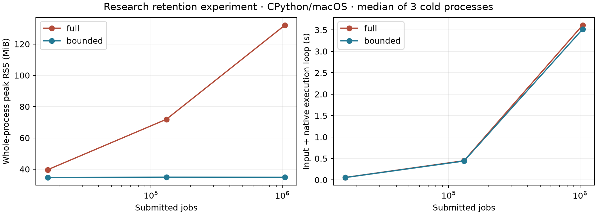

# Bounded-memory native streaming experiment

Date: 2026-11-03. Base: signed `9ecc2629b0db0fa67f1e39efa7e48d60dfff81fa`.
Davide authorized this experiment after establishing the release sequence:
Studio is Simulatte v2; native-engine work is v3 research following a successful
v2 release. Deployment baselines and portable release wheels remain deferred.

## Result

Completed execution history can be reclaimed without changing the tested native
production semantics. At 1,048,576 jobs, bounded direct execution uses **34.83 MiB
median whole-process peak RSS**, versus **132.11 MiB** with full retention. Its
storage stays flat across a 64-fold increase in completed jobs. The managed
Environment path, with semantic digest enabled, shows the same behavior:
**34.98 MiB bounded versus 134.66 MiB full retention** at that size.

All 36 cold-process cases pass independent audits: 18 full/bounded pairs have
identical inputs, eight stock KPIs/windows, completion-history commitments and
canonical native/controller state. Horizon cases also agree across direct and
managed Environment execution. Managed full/bounded ordinary fingerprints match
and contain actual 64-character digests.

This establishes a bounded-retention design for the tested workloads. It does
not establish an unconditional memory bound for an overloaded simulation or an
infinite-lifetime engine. Processing speed remains broadly similar; memory
reclamation and state-query scaling are the useful results.

## Implementation and contract

All changes are research-only under `prototypes/native_engine_streaming/`, with
this report and the approved plan. `native/`, `src/`, package metadata, CI, earlier
research sources and raw evidence are unchanged. The installed experimental
backend retains its existing full-history behavior and state schemas.

The new C layer includes the unchanged validated event-transition implementation
and links the unchanged strict stock-KPI arithmetic in its own translation unit.
A small drain wrapper captures successful job completions. At an advance/run
boundary, bounded mode removes completed jobs and their operations, remapping
calendar entries, resource queues, dispatch history and the EDD pool in stable
order. It preserves unfinished jobs' earlier operations, which are needed for
exact queue-time calculation when those jobs eventually complete.

- `retention="full"` is the research default and preserves completed inspections.
  `retention="bounded"` compacts after successful advancement/final drain.
- Handles use owner-scoped monotonic 64-bit logical identities. Physical offsets
  can move and recycle; identities do not. Completed handles raise
  `ExpiredHandleError` after compaction. There is no growing tombstone dictionary.
  Foreign/closed handles fail safely. Identity/sequence overflow fails explicitly.
- Capacities remain allocated at the high-water outstanding-work size. This is
  reclamation for reuse, not a promise to return a previous backlog peak to the OS.
- Full trajectory extraction remains available through the unchanged packaged
  `NativeStream`. The new research API exposes inspections, scalars and state
  commitments; it is not a new Studio trace/export implementation.

See the [research README](../../prototypes/native_engine_streaming/README.md) for
build, sanitizer, experiment and audit commands.

## State and controller memory

Completed inputs and operation trajectories are encoded in actual completion
order. Python incrementally SHA-256 hashes each completion batch, then releases
it. The batch buffer has a high-water size bounded by work admitted before one
advance; retaining every record in Python would defeat the experiment.

`NBST0001` encodes live logical execution using stable identities, pending work,
queues, policy state and sorted calendar entries. It excludes physical offsets,
capacities and retention mode. `NBDS0001` combines those bytes with the rolling
history commitment, current KPIs and explicit future Python input/controller
state. The encoding supports fingerprint comparison; restoring an engine from these bytes
is outside this experiment. These are new research schemas, separate from installed `NSTA0001` and
`native-production-v1`. Full and bounded digests agree even when compaction occurs
at different advancement partitions. Changed past inputs remain distinguishable
when their execution data has been forgotten and current KPIs happen to agree.

The producer is counter-based. Its callback records seed, cursor, spacing, finite
job limit and input-window size, with no retained workload or RNG history. Handles
are discarded after admission in memory workers. Sampling uses at most 12 fixed
checkpoints per run; it does not collect a sample per producer window.

A dynamic-only `StreamingProduction` research adapter reuses the existing backend
lifecycle without a fixed-job tuple. The Environment test has one backend entity,
one collector and one pending controller event at completion. Digest publication
occurs through the normal activation/finalization lifecycle; optional query costs
are measured separately. Coordinator supervision, captured-source reproduction,
run-store retention, trace spooling and Studio sessions are outside this memory
measurement. No claim extends to those larger workflows yet.

## Measurement design

macOS 27.2 arm64, Apple M4 Pro, CPython 3.14.3, Apple Clang 21, C17/O3, stock
arithmetic alone compiled with `-ffp-contract=off`. The release C engine and Python
extension are separate images with verified source/binary hashes and actual
loaded dependency origin. Every worker checks them before and after execution;
the parent checks before each case and after the matrix.

Final source freeze: **20 files**, SHA-256
`f340ad0f020b60240ed0cb961205ef27859db9de23ec045fa2ca3113959c68f7`.
The build manifest and per-image hashes are in
`prototypes/native_engine_streaming/results/gate/metadata.json`.

The serial matrix has 36 fresh subprocesses, in a deterministic shuffled order:

- Direct full/bounded, 16,384 / 131,072 / 1,048,576 jobs, three paired seeds
  (41–43), arrival spacing 1.5: 18 cases.
- Higher offered load, spacing 1.0, three sizes, seed 41: six cases.
- Overload, spacing 0.125, 16,384 / 65,536 jobs, stopping at the horizon: four cases.
- Direct/Environment horizon controls, both modes, 131,072 / 1,048,576 jobs:
  eight cases. Environment semantic digest is enabled.

All use three unit-capacity servers, three-operation unique-server routes,
deterministic counter-generated inputs with native SPT dispatch, EDD ConWIP cap 12,
warmup 100 and 64-job lazy input windows. The matrix varies seeds, not three
repeat timings of one identical input. Medians and ranges are descriptive; there
are no confidence bounds or cross-platform speed claims. Tests and compilers
were idle throughout timing. Matrix cold subprocess wall time totals about 55 s.

Whole-process peak RSS comes from `getrusage`; current RSS is sampled with `ps`.
Native requested-allocation estimates include reserved job/operation capacities,
calendar, completion/state buffers and exact-sum allocations, excluding allocator
metadata. Requested allocations and OS resident memory are different quantities.

The direct loop times lazy generation/validation, input hashing, copied admission,
advancement, completion hashing and native counter polling. RSS/state observations
are outside that loop timer. `instrumented_loop_seconds` includes them. Environment
loop timings include its diagnostic polling and framework finalization, so timing
comparisons are within the same execution path. Creation, final drain, close,
state queries and cold-process wall time are retained separately. No comparison
with ordinary Python engine speed was made in this gate.

## Memory and runtime

Direct stable-load medians across three paired seeds:

| Completed jobs | Full peak RSS | Bounded peak RSS | Full loop | Bounded loop |
| ---: | ---: | ---: | ---: | ---: |
| 16,384 | 39.67 MiB | 34.69 MiB | 0.0577 s | 0.0557 s |
| 131,072 | 71.89 MiB | 34.91 MiB | 0.4479 s | 0.4405 s |
| 1,048,576 | 132.11 MiB | 34.83 MiB | 3.6123 s | 3.5185 s |

Bounded mode's maximum retained jobs, including future input lookahead, is 68
across these cases. Maximum native requested storage is **40,663 bytes** at all
three sizes; the full-retention estimate grows from 3,970,647 to 252,728,919 bytes.
At the higher load, bounded mode reaches at most 73 retained jobs and 41,687 native
bytes; peak RSS remains 34.69–34.80 MiB across the three sizes.

With Environment/digest enabled at 1,048,576 jobs, the full/bounded loops are
3.591 / 3.596 s. There is no evidence of a substantial throughput penalty or a
new general speed advantage. The single Environment sample per size/mode is a
scaling check, not a replicated performance estimate.

Before the final drain at one million jobs, median state-byte capture (C encoding, controller/
KPI canonicalization and history-digest materialization) is **0.722 ms full versus 0.108 ms bounded**.
The normalized state output is the same 843–1,067 bytes for paired seeds. Full
mode still scans retained history to select live work; bounded mode scans only
its compacted working set. This compares the new research codec in both modes;
it is not a remeasurement of the old `NSTA0001` encoder. The query timer excludes
SHA-256 of the final composite bytes and RSS polling. Final drain and close
are tens of microseconds in these cases and are recorded in raw rows.

## Negative control: outstanding work still needs memory

ConWIP limits the shop floor, not the pre-shop pool. Under overload, bounded mode
retains 14,067 outstanding jobs after 16,384 submissions and 56,326 after 65,536.
Peak RSS grows from 54.52 to 105.89 MiB. Both retention modes have the same KPIs,
state and history commitment at each horizon. This is expected workload growth,
not leaked completed history. Eager input, an unbounded arrival backlog, large
user-retained handle collections or a growing controller callback state can still
consume unbounded memory relative to completed-job count.

## Verification and iterations

- Final release regression selection: **534 passed, 1 skipped**, including all
  dynamic prototype tests, the packaged native API/backend tests and 71 new
  streaming tests. The installed core source/tests/configuration are unchanged;
  this gate does not lower or rerun the global coverage threshold.
- Exact packaged native comparisons cover 48 policy/cap/warmup/seed combinations
  at multiple horizons and final drain. Eight direct comparisons use ordinary
  Python `ShopFloorKPIs`. Irregular lazy windows, live jobs across repeated slot
  reuse, expired IDs, drained/refilled calendars, pure queries and historical/
  future-state changes are tested. Full/bounded/repeated managed runs have equal
  KPIs, native digests and non-null ordinary fingerprints.
- Standalone ASan/UBSan passes **164 full + 156 bounded allocation-failure
  positions**, read-only query failures, 10,000 recycling cycles and identity
  overflow. An additional instrumented fixture crosses the uint32 identity
  boundary. Every failed mutating engine remains safely destroyable.
- The new Python C API boundary is separately ASan/UBSan instrumented against
  the release engine: **71 passed**, `PYTHONMALLOC=malloc`, Python leak detection
  disabled. The standalone gate separately instruments the engine and stock
  helper; this is not a claim of exhaustive leak or thread-safety certification.
- An independent trajectory oracle reconstructs the rolling commitment from the
  unchanged packaged engine's full trajectory arrays in 16 FIFO/SPT, cap/unlimited
  and seed cases; every commitment and scalar snapshot matches.
- Independent audit regenerates **14 input hashes**, checks all **18 paired
  controls**, rejects five deliberately corrupted evidence variants, verifies
  nested artifact hashes and confirms **all 1,688 base tracked files unchanged**.
  The previous six-ABI package audit still passes unchanged.
- Scoped Ruff lint/format and source whitespace checks pass. The earlier
  repository-wide research formatter issue remains outside this experiment.

Draft failures are retained only in ignored `.build`: the initial absent-KPI
representation mismatch (None versus omitted fields), a matrix tuple-arity harness
error, and the first matrix with Environment digest disabled. The last one's
explicit native state/KPIs matched, but normal fingerprints were null. Enabling
digest and requiring a 64-character ordinary fingerprint in the audit corrected
the harness; **the complete final matrix was rerun**, rather than relabeling draft
results. A final replay refinement permits descendant commits while preserving
every base tracked file; the matrix was regenerated after that checker/README
change as well. Timing evidence and its source freeze refer only to the final run.

## Implications and next proposal

The retention/identity/state design passes this bounded-workload feasibility gate.
A long run does not inherently need to retain every completed job, and reclaiming
history need not sacrifice exact stock KPIs or deterministic state commitments.
No installed API/schema migration is included in this experiment. The private C
implementation inclusion is a research technique, not a proposed production
module boundary.

The next proposed step is an opt-in integration into the experimental native
provider, followed by fresh-process Coordinator reproduction and a memory gate
for that complete managed path. Only after that should this become a supported
retention contract. Cooperative cancellation and richer policies remain subsequent
research candidates. No next experiment, release, publication or merge is adopted
by this report.
