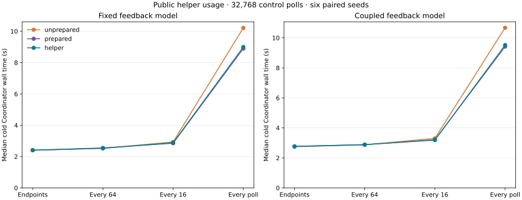
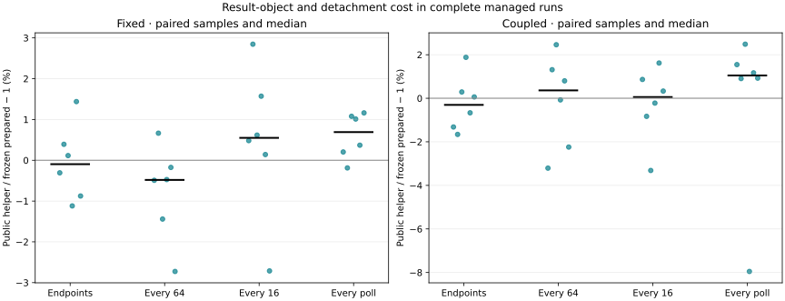

# Public identity helper: end-to-end usage and query attribution

The public helper retains the prepared experiment's benefit with a small wrapper
cost. At periodic identity-query rates, its paired median wall-time difference
from the frozen prepared path is between −0.48% and +0.55%. Under every-poll
stress it costs about 0.7–1.0% more than that path while remaining 10.7–12.1% faster
than the older unprepared consumer. All model artifacts, default fingerprints and
canonical identity endpoints remain exact. No product/provider code changed.

## Method and scope

This is an installed macOS 27.2 arm64 / CPython 3.14.3 study on bigboss, with SimPy
4.1.2 and msgpack 1.2.4. It reuses the exact core/native wheels from the preceding
compatibility gate. It is not new Linux, other-ABI, Python-versus-native-engine or
portable-wheel performance evidence.

Both representative research models use three unit-capacity servers, SPT, ConWIP 4,
outstanding-work limit 12, burst 3 and bounded retention. One model has fixed job
specifications with reporting-independent control; the other uses windowed KPIs
to change admission and requirements. These are model proxies, not production
traces. All controllers still inspect live state at every 0.5-unit control poll.
The varied frequency applies only to additional identity observations.

Each primary run has 32,768 polls, warmup 10 and one of six seeds 100–105. Compare
public helper, frozen prepared and frozen unprepared at endpoints only, every 64
polls (32 simulation units), every 16 polls (8 units), and every poll (stress). Every
model/rate cell uses all six consumer permutations once, with shuffled blocks and
predeclared orders. Each consumer materializes dictionaries and runs the same
independent validator at each identity observation. No cross-query cache is used.

The 144 primary requests run serially in fresh external projects with no runtime
compiler. Six secondary controls disable all identity instrumentation, including
the action ledger. Two further fresh child processes reproduce selected periodic
helper requests after every project Python source is deleted. Total: 152 unique
Coordinator attempts. Cold lifecycle and dispatch-to-publication wall times are
separate; result inspection is outside both timers. RSS is sampled externally;
its completion-poll delay does not enter the primary wall timers. No tests,
builds or profiling ran during final live timing.

After live timing, eight separate query cells cover both models, full/bounded
retention and synchronized boundaries 65/4096. Each compares 12 operations over five
shuffled adaptive 25 ms batches, with normal GC and wall/thread-CPU counters. Profiles
and traced Python peaks are separate from those latency batches. Every measured
model completes with exactly the same artifacts/fingerprint as an uninstrumented
run; native state, callback state, authority and owner generation remain unchanged
across the repeated queries.

## Complete managed wall time

Values below are cold Coordinator lifecycle medians in seconds. Percentages are
medians of six paired seed ratios, not ratios of these medians. Positive values
in the overhead column mean the public helper took longer.

| Model | Identity observations | Helper | Prepared | Unprepared | Helper overhead vs prepared | Helper reduction vs unprepared |
| --- | --- | ---: | ---: | ---: | ---: | ---: |
| Fixed | Endpoints (2) | 2.407 | 2.410 | 2.412 | −0.10% | −0.85% |
| Fixed | Every 64 (514) | 2.532 | 2.553 | 2.525 | −0.48% | −0.22% |
| Fixed | Every 16 (2,050) | 2.883 | 2.853 | 2.936 | +0.55% | +1.79% |
| Fixed | Every poll (32,770) | 8.993 | 8.895 | 10.214 | +0.69% | +12.13% |
| KPI-fed | Endpoints (2) | 2.770 | 2.761 | 2.749 | −0.30% | +0.39% |
| KPI-fed | Every 64 (514) | 2.887 | 2.880 | 2.877 | +0.36% | +0.32% |
| KPI-fed | Every 16 (2,050) | 3.190 | 3.213 | 3.303 | +0.05% | +3.53% |
| KPI-fed | Every poll (32,770) | 9.519 | 9.419 | 10.675 | +1.05% | +10.73% |

Periodic differences from prepared are small and include mixed signs. Paired
helper/prepared ranges are −2.73%…+0.66% and −2.71%…+2.85% for fixed 64/16;
−3.21%…+2.46% and −3.32%…+1.62% for KPI-fed 64/16. These six-seed samples do not
establish a sub-percent universal speed difference. Against unprepared, every 64
has no consistent measurable end-to-end gain here; every 16 has modest gains
(fixed range −0.09%…+3.52%; KPI-fed +1.56%…+4.17%).

Stress gains against unprepared are consistent across all six seeds: fixed
11.03%…13.78%, KPI-fed 9.98%…11.49%. Retain the KPI-fed seed 103 outlier: prepared
10.341 s, helper 9.518 s, unprepared 10.630 s, producing −7.95% helper/prepared overhead.
Its cause was not established; no primary sample was replaced or supplemented.
The remaining stress helper/prepared pairs show small positive overhead, except
one fixed pair at −0.19%.

Dispatch medians corroborate the stress result: fixed helper 8.448 s versus
prepared 8.383 s/unprepared 9.675 s; KPI-fed 9.007 s versus 8.917 s/10.158 s.

Query frequency matters more than wrapper overhead. Relative to the same seed's
endpoint-only helper run, every 64 adds paired median 5.66%/3.99% cold wall time for
fixed/KPI-fed; every 16 adds 20.07%/17.16%; every poll adds 266.45%/243.76%.
Those comparisons keep the action ledger and controller reads constant. Secondary
fully disabled medians (seeds 100–102) are 2.190 s/2.294 s, versus endpoint-only
2.395 s/2.708 s for those seeds. Disabled controls also omit ledger work and run
after the primary blocks; they cannot isolate query cost or establish a causal
ledger-only speedup.

## Query cost and remaining work

Times are uninstrumented batch medians in microseconds per call, including fresh
public hook, dictionary materialization and unchanged validation in the pipelines.

| Model / boundary | Retention | Native query bytes | Helper pipeline | Prepared pipeline | Unprepared pipeline |
| --- | --- | ---: | ---: | ---: | ---: |
| Fixed / 65 | Full | 9,724 | 181.19 | 177.44 | 219.26 |
| Fixed / 65 | Bounded | 1,367 | 182.16 | 178.34 | 217.88 |
| Fixed / 4096 | Full | 565,396 | 349.79 | 342.59 | 381.71 |
| Fixed / 4096 | Bounded | 535 | 154.83 | 151.41 | 187.95 |
| KPI-fed / 65 | Full | 16,116 | 182.25 | 177.47 | 217.09 |
| KPI-fed / 65 | Bounded | 1,519 | 185.72 | 183.24 | 222.61 |
| KPI-fed / 4096 | Full | 952,592 | 508.36 | 505.28 | 551.85 |
| KPI-fed / 4096 | Bounded | 1,671 | 183.83 | 180.22 | 219.51 |

Public composition with dictionaries takes 63.69–73.14 µs versus 61.25–70.41 µs for
prepared: an extra 1.9–2.7 µs at the matched cells. That includes public structural
checks, immutable result construction and detachment implementation differences;
it is not a constructor-only estimate. Complete bounded pipelines reduce
unprepared query cost by about 16–18%. Full late-history cells show
only 7.9–8.4% reduction because the native-state work has grown.

Returning just the immutable composition takes 37.83–43.19 µs. Independent
`to_dict()` costs 25.12–28.66 µs: a substantial part of the 63.69–73.14 µs complete
composition. The independent validator costs 29.13–34.83 µs. In bounded cells,
the fresh managed hook takes 54.56–70.20 µs, versus 4.53–5.53 µs for serialized native
state plus SHA-256 alone. A callback freeze+pack takes about 10 µs at the early
fixed cell; the complete hook still performs both fresh callback reads and guards.

At late full retention, native serialization plus hash costs 189.34 µs fixed and
323.82 µs KPI-fed, approximately 54%/64% of their complete pipeline latency. These
are separate stage timings, not an additive decomposition of the pipeline.
Instrumented self-time attribution agrees directionally: wire preparation,
detachment/access and glue dominate bounded queries; SHA-256 grows to 25–31%
of instrumented late-full self time. Profiler overhead changes those shares, so
they must not be substituted for uninstrumented latency percentages.

Traced composition peaks increase by 864 bytes for the public helper relative to
prepared in every cell; overall traced peaks remain about 292–294 KB, dominated by
the encoder's working allocations. This is not native allocation or process RSS.
No meaningful memory reduction is established by this API wrapper.

## Correctness, resources and provenance

- All 144 primary runs preserve exact artifacts and default fingerprints across
  consumers and rates for each model/seed. Six disabled controls preserve every
  physical artifact/fingerprint while omitting only the identity artifact.
- Both source-deleted reproductions are exact, use fresh attempts and remain
  ordinary pinned Coordinator reproduction. All 152 attempt IDs are distinct.
- All eight query cells preserve complete authority, exact canonical bytes/sizes,
  endpoint fingerprints/artifacts and callback/native state. There are 480 latency
  batches, 40 profiles and 40 separate traced-allocation samples. No private native
  state access occurs in the model consumer; the profiler alone uses existing
  diagnostic state access for invariant checks and the isolated hash stage.
- At the fixed 32,768-poll horizon, observed child peaks span 45.47–46.78 MiB and
  tree peaks 142.64–148.02 MiB across all rates/consumers. Maximum owned handles 12,
  callback 1,291 bytes, native query 2,775 bytes, canonical identity 3,679 bytes and
  native allocation 9,831 bytes. This compares query rates, not new duration scaling
  or arbitrary consumer retention of returned objects.
- 182 focused tests pass in 5.69 s, including eight new research gate cases. Research
  lint/format and `ty check src` pass. Product/provider code is unchanged, so the
  full suite, sanitizer and Linux/ABI checks from f6693d3 were not repeated.
- All 4,244 base files, including APIs/C/provider, old fixtures and earlier evidence,
  remain byte-identical. Eight copied source files are exact. Both final studies
  share the 194-file freeze
  `81d26ef4e54de8803357dc180435e64dad2f58dfcd00bb06069f18fab01935df`.
- Core wheel SHA-256:
  `a57c155a1528976cc8ab76ad589cb692b410b4607373dc15eede1fcacf2a21d6`;
  native cp314 wheel:
  `c9045808af932adda56455a4b04790f463da0cebb072f823d96eeddeda33b3af`.
  Installed origins, distributions, schedules, every primary sample, artifacts,
  profiles and evidence hashes are retained under
  `prototypes/native_identity_usage/results/`. Both standalone figures were inspected.

## Implications and proposed next experiment

Keep the public helper as the experimental baseline. Its API boundary introduces
little end-to-end cost at the tested periodic rates and retains the prepared
benefit under stress. Identity polling cadence remains a larger decision than
constructor tuning; mandatory controller observations are a separate requirement.
Full-retention hashing still grows with history, and complete callback coverage
remains necessary. Native features, result reuse and release status are unchanged.

The next focused experiment could use a consumer of `canonical_bytes` directly,
materializing dictionaries only when needed. Test it against exact byte-level
oracles and the same complete authority/control outcomes before claiming an
end-to-end saving. The measured 25–29 µs detachment is a candidate opportunity, not
a promised wall-time gain; independent validation must be accounted for explicitly.
No such path was implemented here. Native v3 remains experimental after Studio v2;
no push, deployment baseline, publication or production promotion is included.
