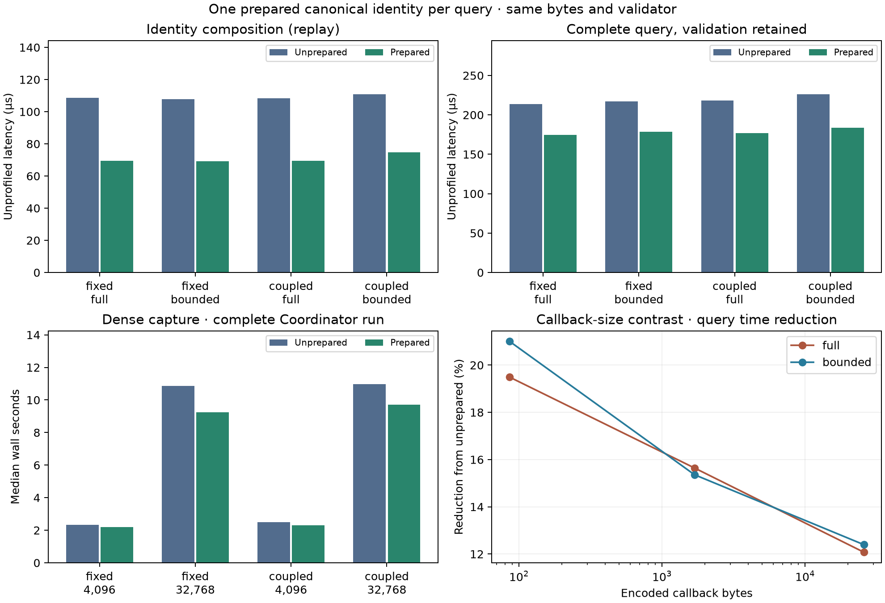

# One prepared canonical identity per query

The experiment passes. Preparing canonical values once per query reduces identity
composition time by roughly 33–36% and the complete sampled query path by about
18%. Dense live-run medians also improve, with an outlier retained and followed up.
Every identity, canonical byte sequence, size, historical artifact and default
fingerprint required by the gate stays identical.

This is a research-consumer optimization at signed base
`b24538a04488179571bc2f49d5d5c3247d022dad`. **All 3,125 existing files remain
byte-identical**, including product/provider code and every earlier experiment.
The public API/default complete digest and local0.17.0/provider-API2 wheel pair
are unchanged. There is no automatic product promotion, push, publication or
deployment-baseline selection.

## Change and preserved contract

The candidate calls the public managed projection once per observation and freezes
that detached view once. Canonical immutable subtrees are reused for trajectory,
reporting and complete component hashes. It builds one canonical envelope, obtains
packed size directly from it, then converts the result to the same plain detached
structure. Existing `freeze`/`canonical_pack` routines provide the wire behavior;
there is no custom encoder, binary-layout parsing or private owner access in the
candidate consumer.

All prepared data is local to that observation. The provider hook still performs
both fresh pure callback reads and its synchronization/mutation checks. Authority
and its complete callback preimage are copied unchanged into the envelope. Future
state changes still change complete identity even when past trajectory does not.
The same independent validator runs on both candidate and unprepared output; size
diagnostics are retained. Returned structures are detached, including repeated
authority/scope branches. No mutable state is cached across queries.

The two fixtures, wrapper, unprepared consumer and binary parser are frozen,
byte-identical source copies. Compare mode requires envelope/size and canonical
byte equality against both old implementations. Tests include random nested
inputs, escaped/Unicode keys, float edges, immutable sharing, mutable output
isolation, callback freshness and changed future authority. Unsupported versions
and non-wire values fail. The candidate path never invokes either old capture.

## Query measurements

The installed study reuses the preceding54 cells:24live(time65 before that poll,
two controllers × two policies × two retentions × three seeds),18completed-history
stress cells and12callback-size stress cells. Every process runs an unprepared
baseline and prepared profiled simulation:108managed executions. All endpoint
artifacts/fingerprints match;16historical endpoints and12callback-isolation controls
also match. Every sampled prepared envelope equals the parser and unprepared
consumer, with unchanged native/controller state and mutation generation.

Twenty operations include paired unprepared/candidate stages. Five randomized
adaptive25ms blocks give5,400raw latency batches. Normal GC and wall/thread CPU
timers are used. Startup, profiling/tracing, tests and compilers are excluded from
latency timing; cProfile and allocation tracing run in separate passes.

Live-state medians (six cell medians per group), µs/query:

| Controller / retention | Unprepared composition | Prepared composition | Unprepared complete path | Prepared complete path |
| --- | ---: | ---: | ---: | ---: |
| Fixed / full | 108.68 | 69.38 | 213.84 | 174.45 |
| Fixed / bounded | 107.77 | 69.20 | 217.35 | 178.46 |
| KPI-fed / full | 108.32 | 69.55 | 218.27 | 177.11 |
| KPI-fed / bounded | 110.98 | 74.77 | 226.43 | 183.62 |

The managed provider hook and validation remain measured stages with unchanged
implementation. The improvement comes from preparing/reusing wire values inside
composition. Its recursive freeze visits fall405–456→170–195 and canonical-map
constructions90–106→31–39 per query. For the whole pipeline, freeze visits fall
717–856→482–595 and canonical maps146–188→87–121. Canonical pack counts stay exactly
11/full or12/bounded per pipeline query: hashing, validation and diagnostics were
not removed to obtain the gain. These counts are from separate cProfile runs;
timing gains use unprofiled batches rather than instrumented percentages.

Larger-state contrasts, medians of three seeds:

| Case | Unprepared composition µs | Prepared composition µs | Unprepared path µs | Prepared path µs |
| --- | ---: | ---: | ---: | ---: |
| 65,536 completed jobs / full | 90.81 | 56.72 | 2,297.45 | 2,283.80 |
| 65,536 completed jobs / bounded | 90.39 | 56.99 | 164.59 | 131.74 |
| 256 extra callback records / full | 1,642.81 | 1,124.76 | 4,044.47 | 3,556.08 |
| 256 extra callback records / bounded | 1,554.07 | 1,088.56 | 3,965.99 | 3,474.39 |

The large full-history query remains dominated by serializing/hashing its native
image, so composition savings barely affect the total. Large callback payloads
retain substantial fresh-read/freezing/detachment cost in the unchanged managed
hook and validator; the complete-path reduction is about12% there.

Tracked eight-query batch peaks show little material change: live composition
median295,378→293,396bytes and pipeline301,598→299,230bytes. These are traced Python
batch peaks with successive return values overlapping, not allocation totals/churn
or native malloc. Reduced map construction/CPU work does not imply a large resident
memory saving. The public detached output is still constructed.

## Live Coordinator gate and bounded retention

The primary clean installed gate has165distinct fresh attempts:72primary cases,
12source-deleted reproductions,18controls and61resource/cost cases plus two further
same-parent reproductions. The72cases span ordinary Python/full/bounded, both
controllers, FIFO/SPT, two seeds and warmup0/10/40. The independent audit verifies
24physical scenarios,4,224decision boundaries and28proof streams, preserving all
72historical artifacts/default fingerprints/identities. All14source-deleted
reproductions are exact. Fixed-controller trajectory invariance and KPI-fed
trajectory divergence remain intact. Dense compare controls retain byte equality
at every captured boundary. Python physical/KPI oracles remain in the gate.

The resource matrix retains the prior18bounded scaling cases,30small query-cost
controls and one same-parent case. It adds12dense32768-poll candidate/unprepared
cases across both controllers and three seeds. Three paired seeds per row:

| Controller | Polls | Unprepared median seconds | Prepared median seconds | Median paired time reduction |
| --- | ---: | ---: | ---: | ---: |
| Fixed | 4,096 | 2.335 | 2.198 | 5.85% |
| Fixed | 32,768 | 10.855 | 9.234 | 15.08% |
| KPI-fed | 4,096 | 2.493 | 2.315 | 7.55% |
| KPI-fed | 32,768 | 10.959 | 9.719 | 11.32% |

These end-to-end times include Coordinator preparation, subprocess startup,
controller/action work, capture, unchanged validation, artifacts and result checks.
They are distinct from query-only timings. Small-run startup/noise dilutes savings.
The reductions are medians of per-seed ratios, so they need not equal a ratio of
the displayed medians. These are exploratory paired measurements, not confidence
intervals or universal simulation speedup guarantees.

One primary fixed/32768/seed102 pair was slower:10.551s unprepared versus11.903s
prepared (-12.82% reduction). It is retained in the table's underlying data.
Because that result disagreed with the other seeds and microbenchmarks, three fresh
supplemental pairs repeated exactly that workload. They gave10.678→9.263s,
10.598→9.534s and10.933→9.304s:10.04–14.90% reductions, median13.26%. All repeat
artifacts/fingerprints match the primary reference. The three randomized pair orders
happened to put unprepared first; that limitation and the original outlier remain
visible. The cause of the initial timing excursion was not established. Follow-up
does not replace primary samples or establish a confidence interval. There are
six additional Coordinator attempts, bringing the total to **171**.

Median child peaks across the scaling sizes stay45.92–46.38MiB. Tree peaks are
144.98/145.13/144.56MiB for fixed and145.86/146.25/144.59MiB for KPI-fed at
4096/32768/262144polls. All predeclared child/tree/parent median-range budgets of
16/24/16MiB pass. At most12handles are owned; maxima are1,329callback bytes,
2,671native query bytes,3,679canonical identity bytes,7,227artifact bytes and
9,831reported native allocation bytes. The repeated parent peak increases2.84MiB
across its two further reproductions, below16MiB. Sizes/identities match each
corresponding unprepared run; the3-byte larger maximum view than the earlier gate
comes from the additional32768-poll dense cases, not a changed encoding.

## Provenance, checks and next step

Both studies run serially outside the checkout on macOS27.2 arm64/CPython3.14.3
with no runtime compilers/prototype imports. Source/archive/native image origins
and wheel bytes are checked. Identical package versions and installed module/asset
bytes are verified across both environments (SimPy4.1.2, msgpack1.2.4). Raw RECORD
hashes differ for distributions with environment-specific generated console
scripts; both raw and normalized module hashes are retained. All3,125base files
are audited byte-for-byte. **149focused tests pass in3.89s**, including17new cases;
Ruff check/format pass. No root-suite/sanitizer repeat is claimed with every
product/provider byte unchanged. No fresh Linux/other-interpreter result is claimed.

Both source freezes cover192files and share SHA-256
`f502a83d4ba3bcdd17c93c64cdf9c49c4790c9df4d78a97f3c56633666dfeb5e`.
Unchanged core/native wheel hashes are
`a58088346220aafc683281923b362e2e24cb58836383e43838b3cdeb8d6a9dec` /
`c9045808af932adda56455a4b04790f463da0cebb072f823d96eeddeda33b3af`.
The initial micro preflight driver had an extra argument; it was corrected before
successful preflight/final timing. Raw final and follow-up evidence remain separate.

The prepared consumer is worth retaining as the baseline for subsequent research.
The next step should consolidate it into an experimental identity-composition
helper with the frozen path kept as an oracle, then validate the integration on
Linux and the supported CPython variants before wider use. Preserve fresh callback
reads, detached outputs, independent validation and complete authority. Cross-query
future-state caching remains outside this result. This change does not promote
the helper or choose production deployment/wheel baselines; those remain deferred
until after successful Studio v2.

Evidence: [predeclared plan](2026-11-04-native-prepared-identity-plan.md),
[query source/metadata](../../prototypes/native_prepared_identity/results/micro-final/metadata.json),
[query audit](../../prototypes/native_prepared_identity/results/micro-final/audit.json),
[live audit and all paired costs](../../prototypes/native_prepared_identity/results/live-final/audit.json),
[outlier follow-up](../../prototypes/native_prepared_identity/results/live-followup/summary.json),
[focused checks](../../prototypes/native_prepared_identity/results/focused-tests.log).

