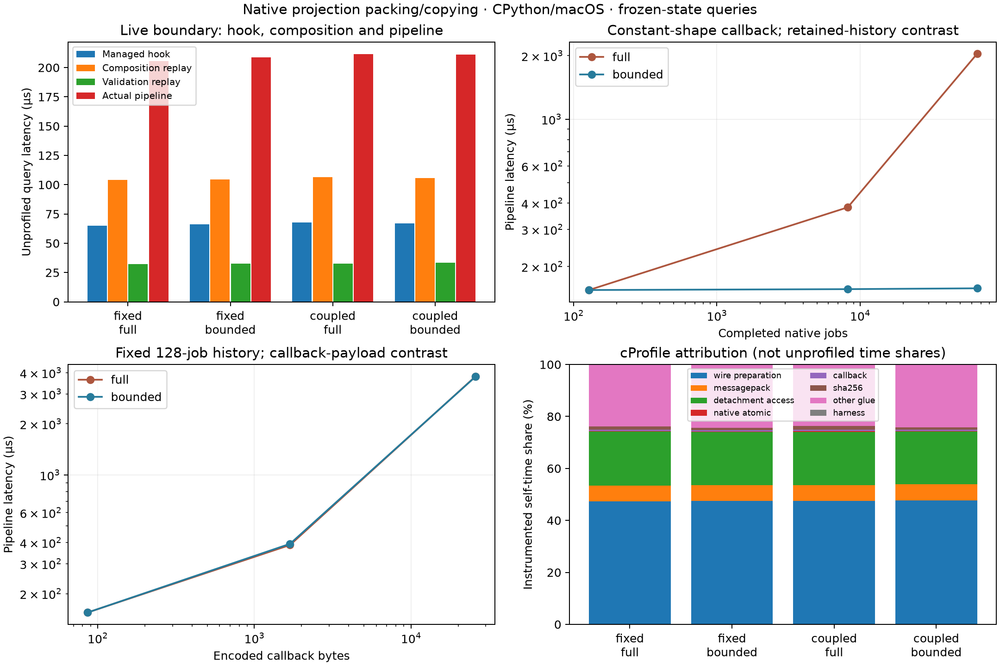

# Projection packing and copying profile

The study identifies repeated canonical preparation and tree copying as the main
cost in the sampled live-state query path. Native atomic capture takes about
1–1.5 µs; the complete hook/identity/validation path takes 205–211 µs. Large
retained history has a different cost pattern: native-byte hashing becomes material.
Large future-controller payloads increase conversion cost in both retention modes.

This is a profiling-only result at signed base
`7580a00817bfcd5fc9337d9377d1b216392db3c3`. **All 2,416 base files remain
byte-identical**, including product/provider code, prior experiments and evidence.
The matching local 0.17.0/API-2 wheels are reused. There is no optimization,
schema/API/fingerprint change, push, publication or deployment-baseline decision.

## Method and verification

The serial installed study runs outside the checkout on macOS 27.2 arm64,
CPython 3.14.3, with compilers unavailable. Its 54 fresh processes each execute
baseline and profiled managed simulations: **108 executions** in total.

- 24 live cells: both original controller fixtures, FIFO/SPT, full/bounded,
  seeds 100–102. Queries sample the synchronized right-open boundary at time 65,
  before that poll, with warmup 10. Simulation time remains fixed during profiling.
- 18 history cells: lazy source, 128/8,192/65,536 completed jobs, both retentions,
  three seeds. Callback shape stays constant; encoded counter widths may change.
- 12 callback cells: 16/256 extra records at 128 completed jobs, both retentions,
  three seeds. Padding is prebuilt and returned by reference by the pure callback,
  isolating conversion/commitment work rather than payload construction. For all
  12 cells, native state and action history equal their zero-padding control while
  complete authority differs.

Seventeen operations have separate unprofiled timings: raw atomic capture, stream
hook, managed hook, composition replay, validation replay, hook+identity, complete
pipeline, parser reference, callback construction/preparation/packing, view
preparation/detachment and packed-size diagnostics. Five randomized adaptive blocks
target 25 ms each, producing **4,590 recorded batches**. Normal GC stays enabled;
wall and thread CPU clocks are both recorded. The no-op median is 11.6–12.3 ns.
Pipeline CPU/wall ratios are 0.9989–1.0000 across cells. Setup/startup, tests,
compilers, process-memory sampling, cProfile and allocation tracing are outside
these latency batches. The virtual-boundary queries deliberately exclude control
polling and action-hash updates.

Separate cProfile passes record self/cumulative times and calls for the managed
hook, composition and pipeline. Explicit self-time categories partition accounted
time without adding inclusive totals. Separate tracemalloc passes record peaks and
retained sites. Raw `.prof`, function tables, batches and traced results are saved.
Composition replay supplies an already captured public view to the unchanged
consumer; it does not cache future inputs in production. Component replay sums
underestimate the live pipeline by median 2.21% (range 1.28–2.88%), so component
latencies are approximate attribution rather than an exact additive identity.

Every measured controller/native state, mutation generation and authority remains
unchanged across queries. Every sampled hook identity equals the frozen parser. All 54
baseline/profiled endpoint artifact sets and fingerprints match, including **16
historical endpoints** for seeds 100/101. **132 focused tests pass**, including nine
new profiler tests. Ruff check/format pass. Product bytes are unchanged, so this
step does not repeat the preceding full suite or sanitizer gate and makes no new
Linux/other-interpreter claim.

Installed dependencies include SimPy 4.1.2 and msgpack 1.2.4. Exact distribution
versions/RECORD hashes, clock implementations and GC thresholds are saved in
`runtime.json`; the study freezes 182 source files, SHA-256
`1964e02edb8ab7f670830d1e9a17d2e5814eeb7160776b06423b1b83a0fa8622`.
Wheel hashes remain the preceding validated pair:
core `a58088346220aafc683281923b362e2e24cb58836383e43838b3cdeb8d6a9dec`,
native `c9045808af932adda56455a4b04790f463da0cebb072f823d96eeddeda33b3af`.
Archive bytes, installed paths, actual native image origins and all evidence hashes
are checked. No runtime prototype imports occur.

## Live-state cost and its implication

Values are medians of six cell medians (two policies × three seeds), in µs/query.
Composition includes the current packed-size diagnostic; validation is the separate
research identity validator called by the preceding per-poll fixture.

| Controller / retention | Native atomic | Stream hook | Managed hook | Composition replay | Validation replay | Actual pipeline |
| --- | ---: | ---: | ---: | ---: | ---: | ---: |
| Fixed / full | 1.23 | 5.67 | 64.94 | 103.96 | 32.32 | 205.50 |
| Fixed / bounded | 1.35 | 7.27 | 66.16 | 104.55 | 32.77 | 208.73 |
| KPI-fed / full | 1.48 | 7.87 | 67.90 | 106.38 | 32.65 | 211.32 |
| KPI-fed / bounded | 1.45 | 7.56 | 67.13 | 105.51 | 33.46 | 210.96 |

About half of the observed work is in model identity composition, about one third
in the managed hook, and about one sixth in research validation. The generic public
managed hook itself costs 65–68 µs in these states; 205–211 µs is the larger
experimental query path. Its packed-size diagnostic alone costs 31–32 µs in replay,
approximately 15% of the pipeline. Validation and that diagnostic together account
for roughly 30% by replay comparison. These are identified research costs, not all
unavoidable public-provider work.

Unprofiled primitive measurements support the conversion finding:

- Building the actual callback dictionary takes 1.25–1.46 µs. Building, freezing and
  packing it takes median 10.14 µs; packing its already canonical captured form
  takes 1.76 µs. Callback invocation alone is small for these controllers.
- Freezing the captured managed view takes median 17.70 µs; detaching its already
  frozen form takes about 19.5–19.8 µs. The same information is subsequently walked
  again for identity hashes, plain output, size packing and validation.
- The actual pipeline executes 11 canonical pack calls in full mode and 12 in
  bounded mode. Across live cells it invokes recursive `freeze` 717–856 times,
  constructs 146–188 canonical maps, visits 121–146 nodes in managed detachment and
  156–181 nodes in identity plain conversion per query. Recursive counts are node
  visits, not that many complete-tree passes.

cProfile assigns about 47.4–47.7% of instrumented self-time to wire preparation and
20.3–20.8% to detachment/mapping access; MessagePack-related functions get about
6.0–6.2%. Those shares **are not unprofiled CPU percentages**: the profiler slows
live pipeline queries by 3.59–3.73× and disproportionately instruments recursive
Python work. Unprofiled component/primitive timings and controlled stressors provide
the independent evidence. Cumulative profile times remain available for inspection
but are not summed into category percentages.

The 205–211 µs query range implies about 0.84–0.87 seconds for 4,096 identical
queries, comparable in scale to the preceding dense-capture overhead. This is an
illustration, not an end-to-end prediction: that experiment visits changing states
and also includes startup, controller/action work, traces and result handling.

## What changes with history and callback size

Constant-shape callback; medians of three seeds:

| Completed jobs | Full state bytes | Full pipeline µs | Bounded state bytes | Bounded pipeline µs |
| ---: | ---: | ---: | ---: | ---: |
| 128 | 11,388 | 154.74 | 479 | 154.74 |
| 8,192 | 721,020 | 381.82 | 479 | 156.21 |
| 65,536 | 5,767,292 | 2,043.39 | 479 | 157.65 |

Full mode's 65,536-job native atomic query takes 244.96 µs and its stream hook
1,896.55 µs; hashing the retained byte image becomes a large cost. Bounded query
cost stays nearly flat over 512× more completed jobs. This concerns serialized
query material and cost, not a new whole-workload resident-memory guarantee.

There is a useful large-history distinction from the previous small-case result:
the frozen parser pipeline costs 11,020.83 µs at 65,536 full-retention jobs versus
2,043.39 µs for the provider hook, about **5.4× faster for this query-only workload**.
The parser reference repeatedly serializes/hashes the full history while checking
its authority. The provider captures it once and reuses the physical digest.
This does not establish an engine-versus-Python simulation speedup or contradict
the preceding small/bounded end-to-end result.

Fixed 128-job history; additional callback records:

| Records | Callback bytes | Full managed µs | Full pipeline µs | Bounded managed µs | Bounded pipeline µs |
| ---: | ---: | ---: | ---: | ---: | ---: |
| 0 | 86 | 40.94 | 154.74 | 40.14 | 154.74 |
| 16 | 1,688 | 145.76 | 386.81 | 146.24 | 393.03 |
| 256 | 25,816 | 1,705.91 | 3,810.92 | 1,701.32 | 3,796.08 |

Callback construction stays about 0.11 µs and native state/action history stays
equal. The larger cost is introduced by preparing, committing, copying and checking
the larger declared future state. At 256 records, freezing the callback costs about
451–458 µs and detaching the managed view about 490–494 µs. Bounded native retention
does not make a large Python controller commitment cheap.

Tracemalloc's eight-query batch peaks are about 284 KiB for managed live queries
and 295 KiB for the live pipeline; the padded pipeline reaches about 811 KiB.
The largest full-history pipeline peaks near 5.79 MB, while the bounded history
pipeline remains near 297 KB. These measurements include transient data and two
successive return values overlapping in the batch loop. They are neither exact
one-query allocation totals nor total allocation churn, and exclude native malloc.
Retained-site snapshots are saved separately; low retained memory would not remove
the CPU cost of repeated preparation/copying.

## Recommended next experiment

Prototype **one canonical prepared representation per query** in identity
composition. Reuse prepared subtrees for the three component hashes, and calculate
the size from the prepared envelope before converting the public result to plain
detached data. Check the resulting bytes, identities, artifacts and full original
authority against this frozen reference at every boundary. Measure it with the
same unprofiled timing protocol, then the existing live end-to-end gate.

Keep fresh callback reads, synchronization/mutation checks and complete authority.
Prepared values may be reused within one observation; caching future-controller
state across polls would require an additional invalidation contract and is not
supported by this result. Keep research validation as a separate measured stage
so a conversion improvement cannot be confused with dropping correctness checks.
This optimization is proposed, not implemented here.

Evidence: [predeclared plan](2026-11-04-native-projection-profile-plan.md),
[source/wheel metadata](../../prototypes/native_projection_profile/results/macos-final/metadata.json),
[runtime versions](../../prototypes/native_projection_profile/results/macos-final/runtime.json),
[independent audit and all per-cell summaries](../../prototypes/native_projection_profile/results/macos-final/audit.json),
[raw batch/profile hashes](../../prototypes/native_projection_profile/results/macos-final/verification.json),
[focused checks](../../prototypes/native_projection_profile/results/focused-tests.log).

